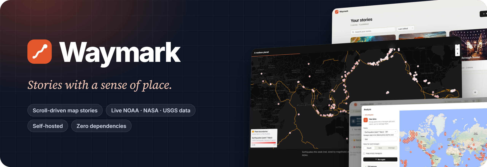
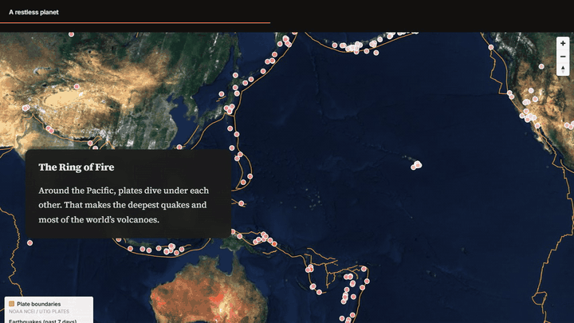
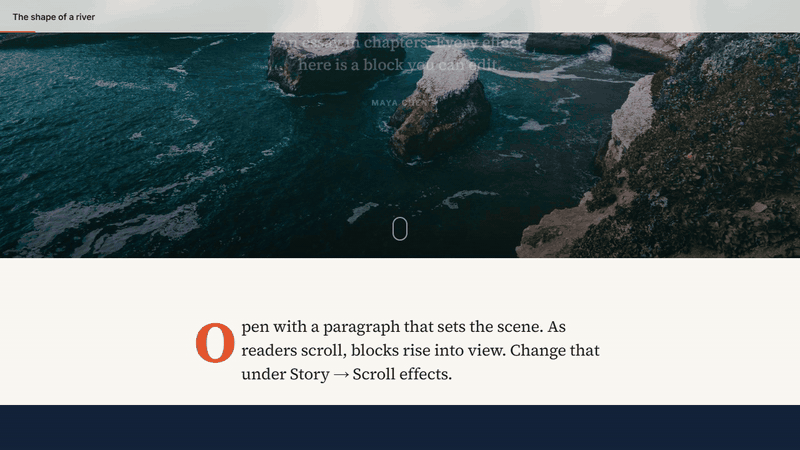
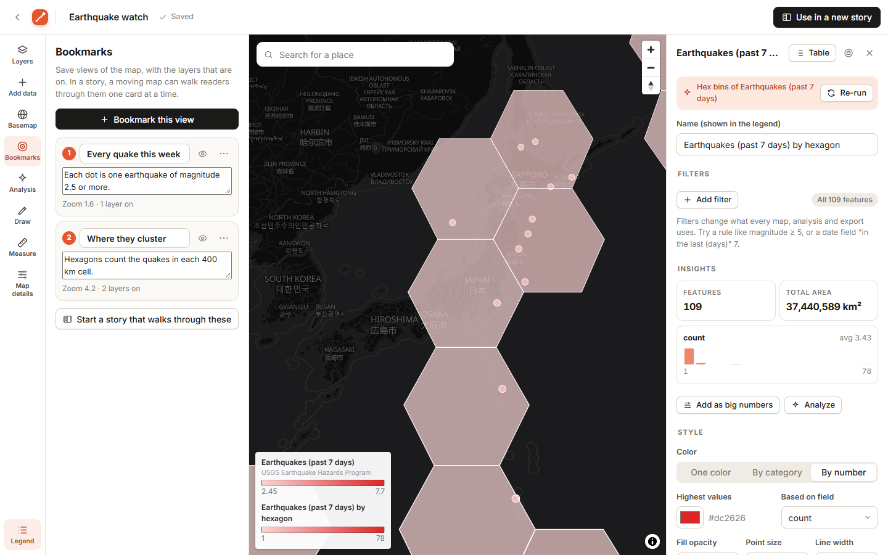
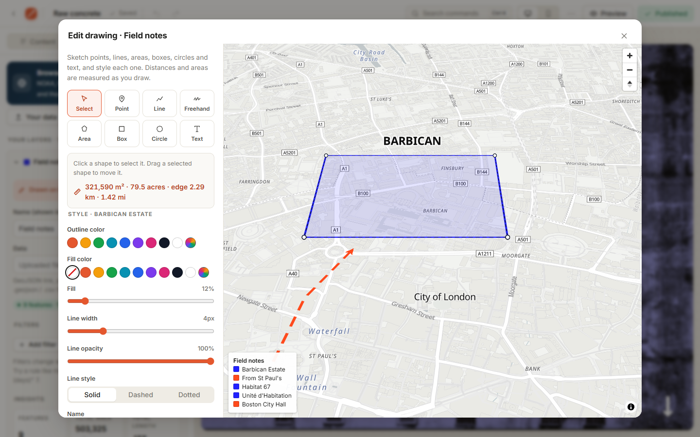
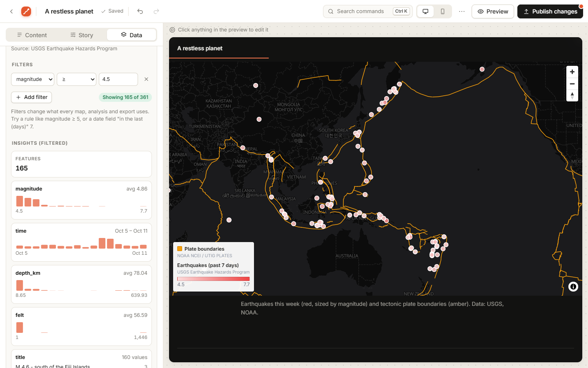
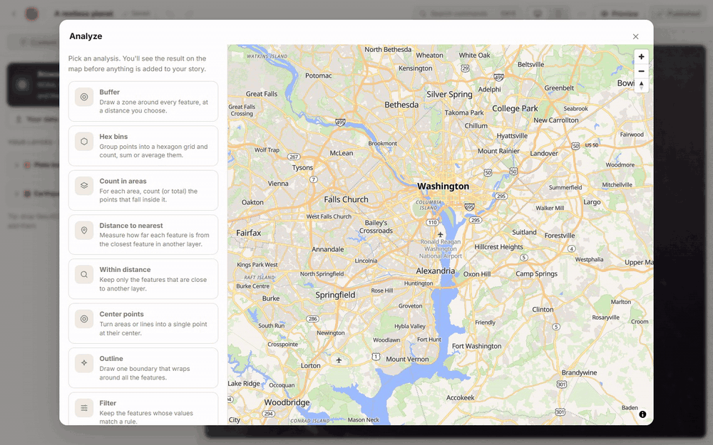
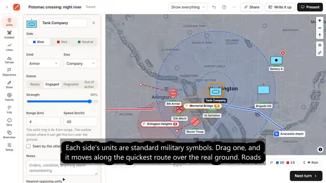
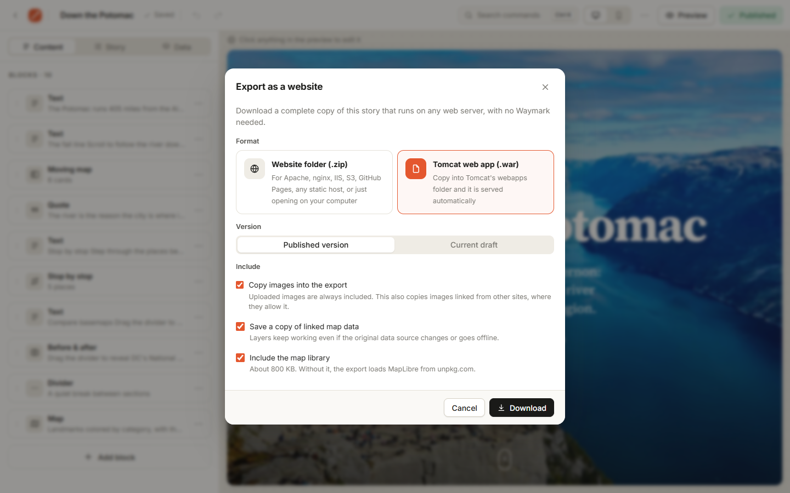

<p align="center">
  
</p>

<p align="center">
  <a href="LICENSE"></a>
  
  
  
  
</p>

<p align="center">
  <b>Write a story. Build reusable maps. Analyze data. Run tabletop scenarios. Publish anywhere.</b><br>
  Waymark is a zero-dependency, self-hosted geospatial storytelling and mapping studio.<br>
  No build step, no API keys, no vendor lock-in — just Node.js and a single SQLite database.
</p>

<p align="center">
  <a href="#-start-in-a-minute">Quick start</a> ·
  <a href="#-at-a-glance">Features</a> ·
  <a href="#-stories">Stories</a> ·
  <a href="#-saved-maps-live-data--3d">Maps &amp; 3D</a> ·
  <a href="#-spatial-analysis">Analysis</a> ·
  <a href="#-scenarios--wargaming">Scenarios</a> ·
  <a href="#-host-it-yourself">Self-hosting</a> ·
  <a href="public/help/index.md">User guide</a>
</p>

<br>

<p align="center">
  
</p>

<br>

## ⚡ Start in a minute

You only need [Node.js](https://nodejs.org) **22.13 or newer**. There is nothing to `npm install`.

```bash
git clone https://github.com/chrispy90/waymark.git
cd waymark
npm start
```

Then open **http://localhost:5180**:

1. **Create your account.** The first visit makes you the owner.
2. **Start with the wizard.** Pick what you're making and a look, add a title and places, and Waymark scaffolds the story.
3. **Click anything to edit it.** When you're ready, press **Publish** or **Export as a website**.

> [!TIP]
> **Windows:** if PowerShell blocks scripts, run `node server.js`.
> **Docker:** `docker compose up -d` runs Waymark with persistent data in a named volume.

<br>

## 🗺️ At a glance

| Workspace | What it does |
|---|---|
| **[Stories](#-stories)** | Scroll-driven map narratives with moving maps, photo tours, swipe comparisons, interactive charts/Sankey flows, scroll effects, and 8 one-click looks. |
| **[Saved Maps & 3D](#-saved-maps-live-data--3d)** | Full-screen cartographic editor with live NOAA/NASA/USGS/ArcGIS data, 3D elevation & city buildings, 3D extrusions, bivariate choropleths, STAC Sentinel-2 imagery, drawing, and bookmarks. |
| **[Spatial Analysis](#-spatial-analysis)** | 30 browser-native GIS tools (summarize, proximity & road routing, overlay, terrain & viewsheds, data management) with live previews before saving. |
| **[Hosted Layers & Forms](#-hosted-layers--field-forms)** | Upload GeoJSON, CSV, Shapefiles, GeoPackages, KML, GPX, or geotagged photos; edit attribute tables & run the Field Calculator; auto-serve vector tiles (>20k features); collect points via public mobile forms. |
| **[Dashboards](#-dashboards)** | Pair any saved map with big numbers, bar charts, donuts, and tables that cross-filter each other and follow the map viewport. |
| **[Scenarios & Wargaming](#-scenarios--wargaming)** | Turn-based tabletop exercises on real DEM/OSM hex terrain with MIL-STD-2525 units, supply lines, C2 latency, viewsheds, Monte Carlo combat, branching, second-screen projector mode, and one-click Story Map briefings. |
| **[Teams, Sharing & Export](#-teams-sharing--export)** | Groups with Viewer/Editor roles, public links & `/u/you` author pages, PDF/PNG print layouts, and standalone static `.zip` or Tomcat `.war` exports. |

<br>

## ✨ Stories

Build long-form visual stories in a **click-to-edit live preview** with autosave, undo/redo, a command palette (<kbd>Ctrl</kbd>/<kbd>⌘</kbd>+<kbd>K</kbd>), and desktop/phone preview.

- **Moving maps:** the map stays pinned while story cards scroll past, gliding between 3D tilts, layers, time-slider states, or media swaps. Link any text phrase to fly the map somewhere new.
- **Scroll effects, built in:** word-by-word **Statements**, horizontal **Scroll galleries**, recoloring **Chapters**, counting **Big numbers**, **Before & after** map/satellite swipes, and parallax/zoom covers — all mobile-ready and honoring `prefers-reduced-motion`.
- **Tours from phone photos:** drop a batch of geotagged JPEGs into the **Stop by stop** tour builder and each photo becomes a numbered stop where it was taken, ordered by timestamp.
- **Interactive charts, Sankey & network graphs:** add **Chart & table** blocks (bars, columns, donuts, executive tables, multi-stage Sankey flows, and force-directed or geo-pinned network graphs) with bidirectional map brushing and curved O–D flow arcs.
- **Eight handcrafted looks:** restyle typography, color palettes, map styles, and scroll animations in one click.

<p align="center"></p>

<table>
  <tr>
    <td width="50%"></td>
    <td width="50%"></td>
  </tr>
  <tr>
    <td><b>Statement</b>: big type that lights up word by word.</td>
    <td><b>Scroll gallery</b>: scroll down and photos slide sideways.</td>
  </tr>
</table>

<p align="center"></p>

<details>
<summary><b>All 8 looks &amp; 5 wizard starting points</b></summary>

<br>

**Looks:** **Classic** (warm paper & serif) · **Night** (dark cinematic) · **Brutalist** (raw monospace, hard edges, acid-yellow stickers & ticker) · **Atlas** (parchment, sepia maps & compass rose) · **Aurora** (dark glass, drifting light & glowing map features) · **Editorial** (magazine journalism with drop-caps & crimson rules) · **Blueprint** (Prussian navy CAD grid & telemetry) · **Fog** (drifting storm layers, pointer lantern & live visibility readout).

**Wizard templates:** **A journey** (moving map) · **A walking tour** (numbered photo stops) · **An illustrated essay** (full-screen chapters) · **A data story** (map + numbers & context) · **Start from scratch** — plus **Explore an example** for finished sample stories.

</details>

<br>

## 🌍 Saved Maps, Live Data & 3D

Build a map once in the full-screen **Map Editor**, then reuse it across any number of stories and dashboards. Edit the map once and every published story that uses it updates automatically.

<p align="center"></p>

- **Live public data, no API keys:** one-click layers from **USGS** (live earthquakes, stream gauges), **NOAA** (weather warnings, live radar, tides, volcanoes), **NASA** (EONET events, daily imagery, Earth at night), **Census / NPS / USFS / EPA / NIFC** (wildfires, parks, states/counties), **Natural Earth**, and **ArcGIS Online** search.
- **3D terrain, buildings & multivariate cartography:** toggle Mapzen Terrarium global DEM elevation (1×–3× exaggeration), OpenFreeMap extruded 3D city buildings, a live pitch HUD (up to 85°), **3D attribute polygon/hexbin extrusions**, **3×3 bivariate choropleths**, heatmaps, clusters, proportional symbols, and a **time slider**.
- **Remote sensing & STAC satellite finder:** one-click NASA MODIS spectral overlays (NDVI, False-Color 7-2-1, Sea Surface Temp, Aerosol Optical Depth, NDSI snow), live **Copernicus Sentinel-2 L2A** search via Element84 STAC with 10 m COG streaming, and multi-date **Time-Travel** before/after swipe.
- **Draw, measure & bookmarks:** sketch styled points, lines, freehand routes, polygons, circles, arrows, and labels with live geodesic measurements; save named camera **Bookmarks** and turn them into moving-map story cards in one click.

<p align="center"></p>

<br>

## 📐 Spatial Analysis

**Filters** narrow any layer with plain rules (*magnitude ≥ 5*, *in the last 7 days*) across maps, live insights histograms, analysis, and exports. **Analyze** runs **30 browser-native GIS tools** with live map previews before saving results as ordinary layers you can re-run anytime.

<table>
  <tr>
    <td width="50%"></td>
    <td width="50%"></td>
  </tr>
  <tr>
    <td><b>Filters &amp; insights</b>: live histograms and feature counts.</td>
    <td><b>Hex bins</b>: a week of earthquakes aggregated into 350 km hexagons.</td>
  </tr>
</table>

<details>
<summary><b>All 30 analysis tools (5 toolboxes)</b></summary>

<br>

| Toolbox | Tools |
|---|---|
| **Summarize** | Hex bins (count/sum/avg) · Hot-spot & outlier analysis (Getis-Ord $G_i^*$ & Local Moran's $I$) · Spatial density clusters (DBSCAN) · Count in areas · Dissolve |
| **Proximity & Routing** | Buffer · Multi-ring trade areas · Gravity & Huff market share (2SFCA & O–D flows) · Hub & spoke desire lines · Distance to nearest · Within distance · Voronoi areas · **Route along roads** & **Travel-time isochrones** (via Valhalla; configure `ROUTING_URL` for heavy use) |
| **Overlay** | Clip · Erase · Intersect · Join by location · Select by location · Merge |
| **Terrain** | Cost surface & accessibility grid (Tobler slope friction) · Least-cost path & corridor · 3D viewshed & line of sight (with Earth curvature) · Elevation profile & slope grade % |
| **Manage data** | Join attributes by field · Center points · Convex hull · Simplify · Add geometry attributes · Filter |

</details>

<br>

## 🗂️ Hosted Layers & Field Forms

Store and manage your own geospatial datasets directly on your Waymark server:

- **Universal GIS ingest:** drop **GeoJSON**, **CSV**, zipped **Shapefiles**, **GeoPackages** (`.gpkg`, up to 256 MB), **KML/KMZ**, **GPX**, or **geotagged JPEG photos** — or connect external **WMS, WMTS, WFS, XYZ tiles, and PMTiles** services.
- **Fast at scale:** hosted layers with more than 20,000 features automatically serve as on-demand **vector tiles** (`.mvt`).
- **Editable attribute table & Field Calculator:** edit cells inline, manage schema columns, inspect live column stats, and compute expressions using column math, rankings, or geometry/elevation variables (`$AREA_KM2`, `$LEN_KM`, `$LAT`, `$LON`, `$ELEVATION_M`).
- **Version history & scheduled sync:** restore any of the last 25 versions, or schedule automatic refreshes (15 min to weekly) from any remote GeoJSON, CSV, or ArcGIS endpoint.
- **Public field forms:** attach a phone-friendly intake form (`/f/…`) to any hosted point layer so contributors can drop a pin, answer questions, and attach a photo — submissions appear live on every connected map and dashboard without exposing existing records.

<br>

## 📊 Dashboards

Pair any saved map with **big numbers**, **bar charts**, **donuts**, and **tables** built from its layers. Click any bar or slice to cross-filter the map and every other widget; toggle **Only what's in view** so every metric recalculates dynamically as you pan and zoom. Share with your team, via public link (`/d/…`), or as an iframe embed.

<br>

## 🎯 Scenarios & Wargaming

[](docs/media/scenarios-explainer.mp4)

**[▶ Watch the 2½-minute explainer](docs/media/scenarios-explainer.mp4)** — turn any map into a turn-based tabletop exercise driven on one screen (with an optional synchronized **second-screen projector view** and read-only public page at `/w/…`).

- **Doctrinal units & real ground:** standard **MIL-STD-2525** military symbols or civic badges moving turn by turn over a hex grid built from real DEM elevation and OpenStreetMap roads, rivers, forests, and urban areas.
- **Logistics, C2 & sensors:** supply depots, lines of communication, bridge demolitions, headquarters **C2 order latency**, finite munitions/sorties, **terrain-masked sensor viewsheds**, and multi-turn **reach isochrones**.
- **Adjudication & branching:** editable 1d6 combat table, **Monte Carlo combat simulator**, matrix-game arguments, scripted injects, weather/daylight effects, MGRS grid, **ghost branch diff overlays**, and a **synchronization matrix**.
- **One-click after-action briefing:** export turns, charts, heat maps, synchronization matrix, and hotwash notes directly into an executive **Story Map** ready to share.

<details>
<summary><b>More scenario &amp; facilitation features</b></summary>

<br>

- **Simultaneous planned moves:** each side plans moves privately, then reveals and resolves contacts together.
- **Fog of war & per-side views:** switch between Facilitator, Blue, and Red perspectives with automatic spotting from sensor ranges and line of sight.
- **Timeline, replay & templates:** animated turn replay, CSV unit/inject import, reusable scenario templates, and portable scenario files for moving exercises between Waymark servers.

</details>

<br>

## 👥 Teams, Sharing & Export

- **Teams & roles:** create groups on the **Team** tab and share any story, saved map, hosted layer, dashboard, or scenario with individuals or groups as a **Viewer** or **Editor**.
- **Public links, embeds & author pages:** publish stories at `/s/…`, maps at `/m/…`, dashboards at `/d/…`, forms at `/f/…`, and curate your own portfolio at `/u/your-handle`.
- **Print layouts:** export any saved map to publication-ready **PDF or PNG** with title, legend, scale bar, north arrow, and credits.
- **Host stories anywhere:** export any story as a self-contained **Website folder (`.zip`)** for GitHub Pages, S3, Netlify, nginx, or offline viewing, or as a **Tomcat web app (`.war`)** — via the editor or CLI (`node server.js export my-story`).

<p align="center"></p>

<details>
<summary><b>CLI export options</b></summary>

<br>

```bash
node server.js stories                                      # list stories & slugs
node server.js export my-story                              # published story as .zip
node server.js export my-story --draft                      # unpublished draft
node server.js export my-story --war --out ./my-story.war   # Tomcat .war bundle
```

Flags: `--war`, `--draft`, `--out <file>`, `--no-images`, `--no-data`, `--no-vendor`.

</details>

<br>

## 🏠 Host it yourself

Everything — accounts, stories, maps, hosted layers, uploads, and scenarios — lives in one `data/` folder. Waymark runs anywhere with Node 22.13+ or Docker and a persistent disk.

1. **Put it behind HTTPS** (e.g. `caddy reverse-proxy --from stories.example.com --to localhost:5180`).
2. **In `.env`**, set `APP_URL=https://stories.example.com` and `COOKIE_SECURE=1`.
3. **Once accounts are created**, set `ALLOW_SIGNUP=0` to lock registration.
4. **Back up `data/`** — it holds the SQLite database and all uploads.

<details>
<summary><b>Environment settings (<code>.env</code>)</b></summary>

<br>

Copy `.env.example` to `.env`. Every variable is optional.

| Setting | Default | Purpose |
|---|---|---|
| `APP_NAME`, `APP_TAGLINE` | `Waymark` | Custom branding in UI, emails, and link previews |
| `PORT` / `HOST` | `5180` / localhost | Listen port and bind address (`0.0.0.0` for LAN/Docker) |
| `APP_URL` | `http://localhost:PORT` | Public base URL for reset links and embeds |
| `DATA_DIR` | `./data` | Location of `waymark.db`, layers, and uploaded images |
| `COOKIE_SECURE` | off | Set to `1` behind HTTPS |
| `ALLOW_SIGNUP` | on | Set to `0` to disable new registrations |
| `SMTP_*` | off | Optional SMTP settings for password-reset emails |
| `MAX_LAYER_MB` | `256` | Max hosted-layer upload size |
| `TILE_THRESHOLD` | `20000` | Feature threshold for automatic vector-tile serving |
| `ROUTING_URL` | public Valhalla demo | Routing server for road routes and travel-time areas |
| `ALLOW_PRIVATE_FETCH` | off | Set to `1` to allow scheduled sync/services on private networks |

</details>

<details>
<summary><b>CLI admin, password reset &amp; dev commands</b></summary>

<br>

```bash
npm run dev                                   # auto-restart server on changes
npm test                                      # run test suite against a temp DB
docker compose up -d                          # run in Docker with named volume
npm run users                                 # list accounts
npm run reset-link -- someone@example.com     # print a one-time reset link
npm run set-password -- someone@example.com   # set a password directly
```

Without `SMTP_*` configured, password-reset links print directly to the server terminal.

</details>

<br>

## 📚 Under the hood

Waymark is plain JavaScript with **zero runtime dependencies and no build step**. The server uses Node's built-in modules (`node:http`, `node:sqlite`, `node:crypto`), and the browser app uses native ES modules with [MapLibre GL JS](https://maplibre.org/) and [Turf.js](https://turfjs.org/) (editor only) on free [OpenFreeMap](https://openfreemap.org/) and Sentinel-2 basemaps.

<details>
<summary><b>Project layout</b></summary>

<br>

```
server.js              entry point & startup checks
server/                HTTP API, SQLite schema, scrypt auth, access/teams, GeoPackage, MVT tiles, SMTP, CLI
public/                browser app (plain ES modules, no bundler)
  builder.html         story editor (js/builder.js, js/wizard.js, js/tour.js, js/render.js, js/effects.js)
  map.html             saved-map editor (js/mapeditor.js, js/maps.js, js/analysis.js, js/workbench.js, js/print.js)
  dashboard.html       interactive dashboards (js/dashboard.js)
  scenario.html        wargaming & scenarios (js/scenario*.js, js/mgrs.js)
  form.html            public field data-collection forms (js/form-page.js)
  help/                built-in 22-page Markdown user guide served at /help
docs/SCHEMA.md         story & saved-map JSON schemas
test/                  API & unit test suite (node:test)
```

</details>

<details>
<summary><b>HTTP API overview</b></summary>

<br>

All state-changing requests require `X-Waymark: 1` for CSRF protection.

| Area | Endpoints |
|---|---|
| **Auth & Profile** | `POST /api/auth/{signup,login,logout,forgot,reset,password}` · `GET/PUT /api/me` · `GET /api/public/users/:handle` |
| **Stories** | `GET/POST /api/stories` · `GET/PUT/DELETE /api/stories/:id` · `POST /api/stories/:id/{publish,unpublish}` · `GET /api/public/:slug` |
| **Saved Maps** | `GET/POST /api/maps` · `GET/PUT/DELETE /api/maps/:id` · `GET /api/maps/:id/usage` · `GET /api/public/maps/:id` |
| **Hosted Layers** | `GET/POST /api/layers` · `POST /api/layers/import` · `GET/PUT/DELETE /api/layers/:id` · `GET /api/layers/:id/{geojson,sample,history,tiles/:z/:x/:y.mvt}` · `POST /api/layers/:id/{restore/:version,refresh}` |
| **Forms** | `GET/POST /api/layers/:id/forms` · `PUT/DELETE /api/forms/:id` · `GET/POST /api/public/forms/:id{,/submit,/photo}` |
| **Dashboards & Scenarios** | `GET/POST/PUT/DELETE /api/{dashboards,scenarios}/:id` · `GET /api/public/{dashboards,scenarios}/:id` |
| **Teams, Sharing & Media** | `GET/POST/PUT/DELETE /api/groups` · `GET/PUT /api/share/:type/:id` · `GET/POST/DELETE /api/uploads` |

</details>

<details>
<summary><b>Security highlights</b></summary>

<br>

- **Auth:** `scrypt` password hashing, hashed session tokens in `HttpOnly; SameSite=Lax` cookies, and rate-limited auth endpoints.
- **Reset links:** single-use, 1-hour expiry, invalidate all active sessions on use, built strictly from `APP_URL`.
- **Content & uploads:** strict HTML tag allow-list sanitization, Content-Security-Policy with no inline scripts, magic-byte upload validation (no SVG), and `nosniff` headers.

</details>

<br>

## 📖 User Guide, Contributing & License

- **User guide:** open **Help** in the app or browse [`public/help/`](public/help/index.md) (22 guides covering every feature, format, and admin task).
- **Schema & changelog:** see [`docs/SCHEMA.md`](docs/SCHEMA.md) and [`CHANGELOG.md`](CHANGELOG.md).
- **Contributing & security:** see [`CONTRIBUTING.md`](CONTRIBUTING.md) and [`SECURITY.md`](SECURITY.md).
- **License:** MIT ([`LICENSE`](LICENSE)). Built from scratch using open formats; credits OpenStreetMap/OpenFreeMap (ODbL), Sentinel-2 cloudless by EOX (CC-BY 4.0), and public-domain US government datasets (USGS, NOAA, NASA, Census, NPS, USFS, EPA, NIFC, Natural Earth).
