<p align="center">
  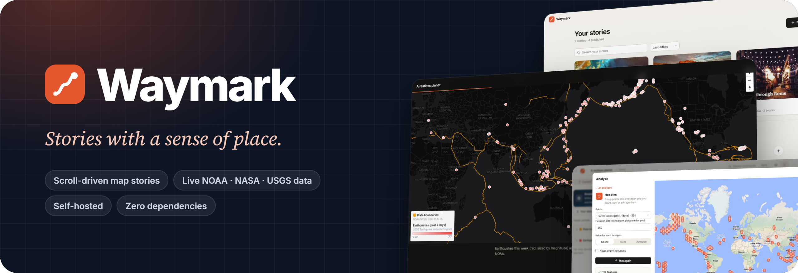
</p>

<p align="center">
  <a href="LICENSE"></a>
  
  
  
  
</p>

<p align="center">
  <b>Write a story. Scroll it. Publish it anywhere.</b><br>
  Waymark is a self-hosted editor for scroll-driven map stories.<br>
  Add maps that move as you read, live government data, and photos, then share a link or export a website.
</p>

<p align="center">
  <a href="#-start-in-a-minute">Quick start</a> ·
  <a href="#-what-you-can-make">Features</a> ·
  <a href="#-publish-it-anywhere">Export</a> ·
  <a href="#-host-it-yourself">Self-hosting</a> ·
  <a href="docs/SCHEMA.md">Story format</a>
</p>

<br>

<p align="center">
  
</p>

<br>

## ⚡ Start in a minute

You only need [Node.js](https://nodejs.org) **22.13 or newer**. There's nothing to `npm install`.

```bash
git clone https://github.com/chrispy90/waymark.git
cd waymark
npm start
```

Then open **http://localhost:5180**.

1. **Create your account.** The first visit makes you the owner.
2. **Answer a few questions.** Pick what you're making and a look, add a title and your places, and Waymark sets up the story for you.
3. **Click anything to edit it.** When you're happy with it, press **Publish**.

> [!TIP]
> **Windows:** if PowerShell says *"running scripts is disabled"*, run `node server.js` instead. It does the same thing.
> **Docker:** `docker compose up -d` also works, and keeps your data in a named volume.

<br>

## ✨ What you can make

### A map that moves with the story

The map stays put while story cards scroll past, and it glides to each card's place. You can tilt it, rotate it, switch layers, or swap it for a photo or video on any card.

<p align="center">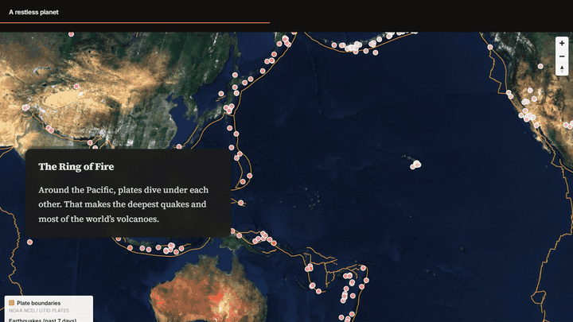</p>

### Scroll effects, built in

Effects from the best long-form sites, available as blocks. Add one and it works on phones too. Each effect switches off for readers who ask their device to reduce motion.

<table>
  <tr>
    <td width="50%">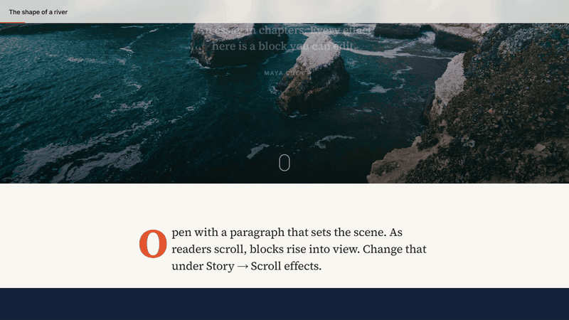</td>
    <td width="50%"></td>
  </tr>
  <tr>
    <td><b>Statement</b>: big type that lights up word by word.</td>
    <td><b>Scroll gallery</b>: scroll down and the photos slide sideways.</td>
  </tr>
</table>

You also get **chapters** that recolor the page, **big numbers** that count up, and **parallax, zoom and wipe-in** photos and covers.

### Live data from NOAA, NASA, USGS and more

Open **Browse public data** and click **Add**. Every layer arrives styled, with popups, a legend and credit to its source. No keys and no sign-ups.

<p align="center">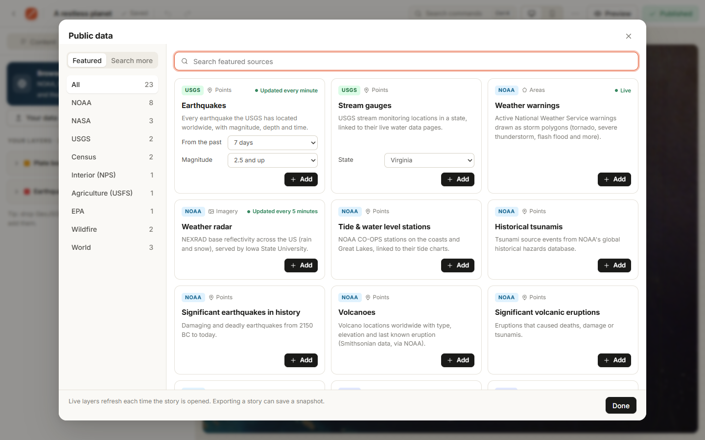</p>

| Source | Layers |
|---|---|
| **USGS** | Earthquakes (live) · stream gauges by state |
| **NOAA** | Weather warnings (live) · radar (live) · tide stations · tsunamis · significant earthquakes · volcanoes · plate boundaries |
| **NASA** | Natural events (EONET) · daily satellite imagery · Earth at night |
| **Census · NPS · USFS · EPA · NIFC** | States and counties · park units · national forests · Superfund sites · active wildfires and perimeters |
| **Natural Earth** | Countries · cities · rivers |
| **ArcGIS Online** | Search thousands more public layers |

Live layers refresh every time someone opens the story, so a published map stays current.

<p align="center">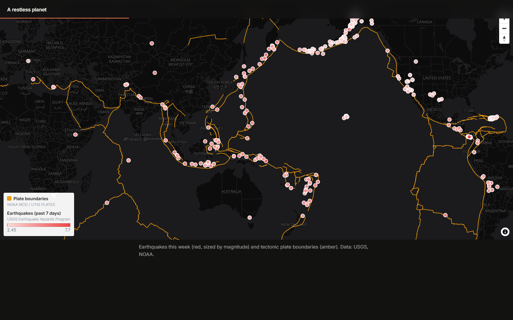</p>

### Filter it, then analyze it

**Filters** narrow a layer with plain rules, like *magnitude ≥ 5*, *in the last 7 days* or *state = Texas*. They apply to the map, the insights, the analysis and the export.

**Analyze** previews every result on a map before you keep it. The tools are buffer, hex bins, count in areas, distance to nearest, within distance, center points, outline and filter. Results become ordinary layers, and you can re-run them on fresh data.

<table>
  <tr>
    <td width="50%">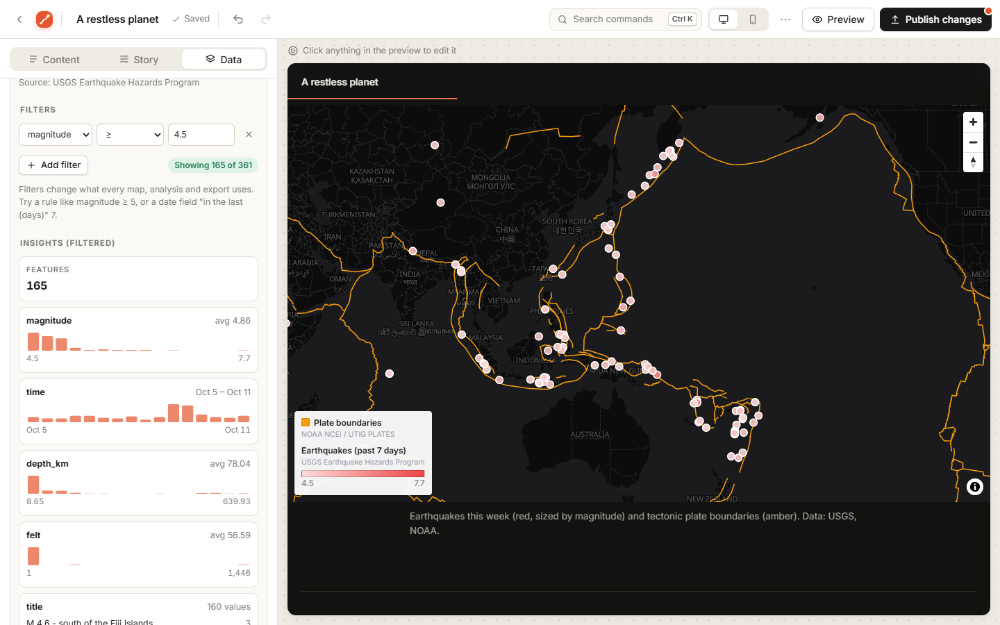</td>
    <td width="50%">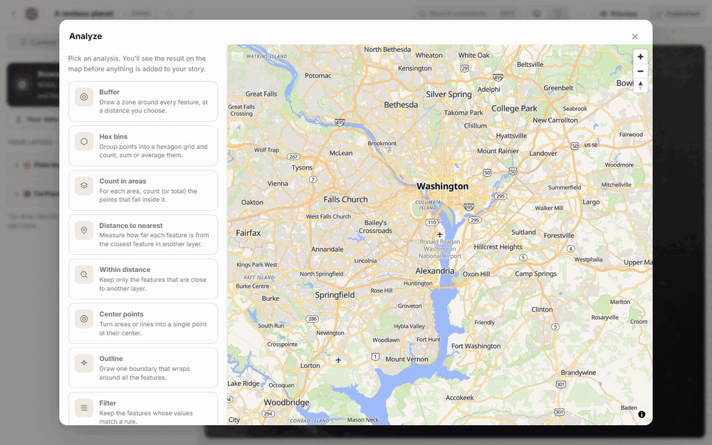</td>
  </tr>
  <tr>
    <td><b>Filters and insights</b>: <i>Showing 165 of 361</i>, with histograms of each field.</td>
    <td><b>Hex bins</b>: a week of earthquakes, grouped into 350 km hexagons.</td>
  </tr>
</table>

You can also show points as a **heatmap** or **clusters**. Bring your own data too: GeoJSON, CSV, or any public ArcGIS layer.

### Draw right on the map

Sketch points, lines, freehand routes, areas, boxes, circles and text labels. Give each shape its own colors, fill, line width, dashes or dots, and an arrowhead, plus a name and a description that readers see when they click it. Distances and areas are measured as you draw. Select a shape to move, restyle or duplicate it, trace over any other layer, and reopen a saved drawing whenever you like.

<p align="center">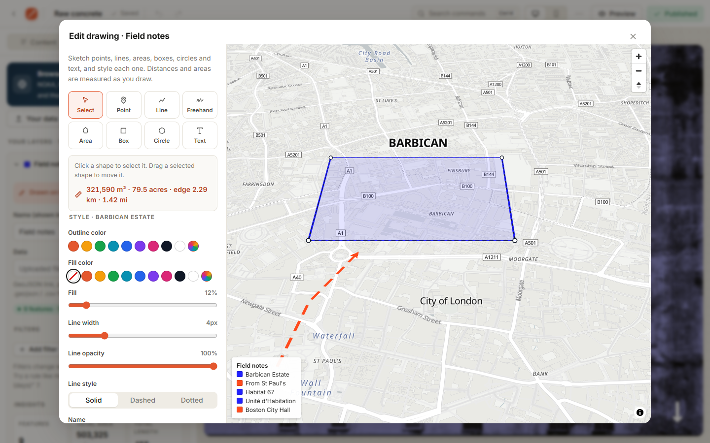</p>

### An editor that gets out of the way

Click anything in the live preview to edit it. You also get drag to reorder, undo and redo, a command palette (<kbd>Ctrl</kbd>/<kbd>⌘</kbd>+<kbd>K</kbd>), a phone preview and autosave. Drafts stay private until you publish again.

<p align="center">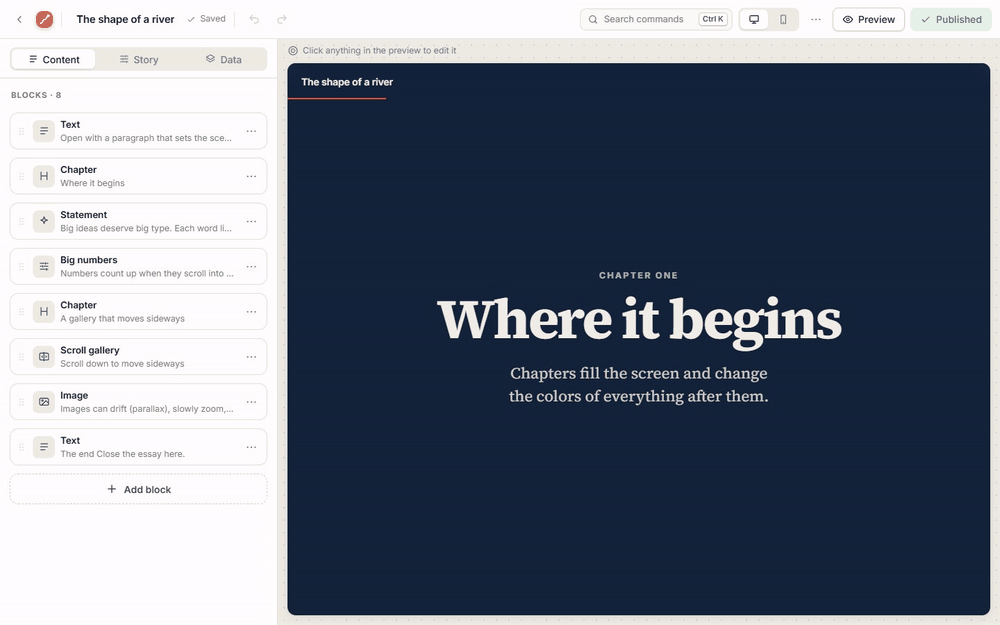</p>

### Make it loud: the Brutalist look

Switch any story to **Brutalist** for raw monospace and heavy display type, hard black edges and offset shadows, acid-yellow stickers, a ticker headline, outlined words that fill in as you scroll, and numbered chapters. Or start from the *Brutalist zine* template.

<p align="center"></p>

### Every story works on a phone

<p align="center">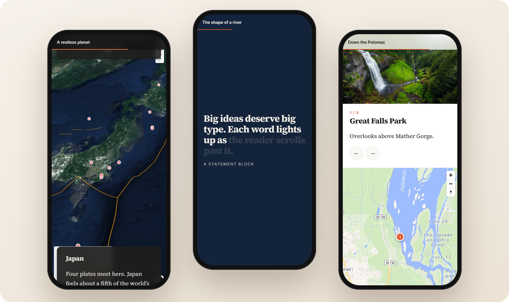</p>

### Start with a few questions, not a demo to delete

**New story** asks what you're making, how it should look, its title and cover, and where it goes. Then it builds the story around *your* places and chapters, with short prompts where your words go. A checklist in the editor walks you through the rest: cover photo, your own text, photos, a phone check and publishing.

<p align="center">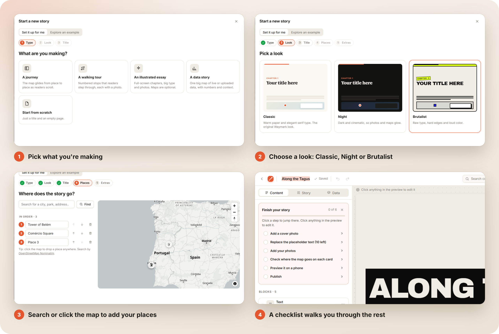</p>

| Kind of story | What you get |
|---|---|
| **A journey** | A moving map with one card per place, plus an overview of the whole route |
| **A walking tour** | Numbered stops with room for a photo and a description each |
| **An illustrated essay** | Your chapters as full-screen titles, with space to write and a photo |
| **A data story** | One big map ready for live or uploaded data, with numbers and context |
| **Start from scratch** | A title and an empty page |

Every kind comes in five **looks**. Each one sets the type, colors, chapter colors, map style and scroll animation. You can switch later under **Story → Look & feel**, and restyle existing chapters and maps to match in one click.

<p align="center"></p>

| Look | Style |
|---|---|
| **Classic** | Warm paper and serif type. The original Waymark look |
| **Night** | Dark and cinematic, so photos and maps glow |
| **Brutalist** | Raw type, hard edges, loud color and a ticker headline |
| **Atlas** | An old atlas: parchment, engraved type and small caps, sepia maps in a double frame with a compass rose, and chapters numbered as plates |
| **Aurora** | Dark glass and drifting light, glowing gradient type, frosted cards and bento-style numbers. Points and lines on its maps glow like fireflies |

Prefer to learn from something finished? **Explore an example** opens a complete story to take apart: the moving map, walk, essay, *Brutalist zine* and *Down the Potomac* samples. Any story can also use **Before & after**, a block with two maps in one view and a draggable divider.

<br>

## 🚀 Publish it anywhere

**Publish** gives a story a public link like `/s/your-story`, with a preview image when the link is shared.

**Export as a website** turns a story into plain files that run on any web server, with no Node, no database and no Waymark.

<p align="center">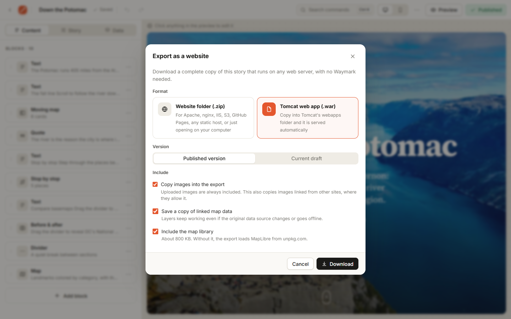</p>

| Format | Use it for |
|---|---|
| **Website folder (.zip)** | Apache, nginx, IIS, shared hosting, S3, GitHub Pages, Netlify, or just double-click `index.html` |
| **Tomcat web app (.war)** | Drop it in Tomcat's `webapps/` folder (Tomcat 8.5 to 11) |

The export includes the page, your images, a snapshot of your map data and, optionally, the map library. Every path is relative, so it works in any folder. You can also export from the command line:

```bash
node server.js export my-story --war --out /opt/tomcat/webapps/my-story.war
```

<details>
<summary><b>All export options</b></summary>

<br>

```bash
node server.js stories                       # find the story's link or id
node server.js export my-story               # published version, as a .zip
node server.js export my-story --draft       # the unpublished draft
```

Options: `--war`, `--draft`, `--out <file>`, `--no-images`, `--no-data` and `--no-vendor`. The last three keep images, data or the map library as links instead of copying them. Only the map tiles and web fonts load from the internet.

</details>

<br>

## 🏠 Host it yourself

Your stories, accounts and images all live in one `data/` folder. Waymark runs anywhere that has Node 22.13+ or Docker and a persistent disk: a VPS, a home server, Fly.io, Railway, Render and so on.

1. **Put it behind HTTPS.** [Caddy](https://caddyserver.com) is the easiest: `caddy reverse-proxy --from stories.example.com --to localhost:5180`
2. **In `.env`,** set `APP_URL=https://stories.example.com` and `COOKIE_SECURE=1`.
3. **Once your accounts exist,** set `ALLOW_SIGNUP=0` to close sign-ups.
4. **Back up `data/`.** It holds everything.


<details>
<summary><b>Settings (<code>.env</code>)</b></summary>

<br>

Copy `.env.example` to `.env` and edit it. Everything is optional.

| Setting | Default | What it does |
|---|---|---|
| `APP_NAME`, `APP_TAGLINE` | Waymark | Rename the app (interface, emails, link previews) |
| `PORT` | `5180` | Port to listen on |
| `HOST` | this computer only | Set to `0.0.0.0` to let other devices on your network connect |
| `APP_URL` | `http://localhost:PORT` | Your site's public address, used in password reset emails |
| `DATA_DIR` | `./data` | Where the database (`storymaps.db`) and uploaded images are stored |
| `COOKIE_SECURE` | off | Set to `1` when the site is served over HTTPS |
| `ALLOW_SIGNUP` | on | Set to `0` to stop new sign-ups once your accounts exist |
| `SMTP_*` | off | Email for password resets. See below |

</details>

<details>
<summary><b>Password reset and email</b></summary>

<br>

People can reset a forgotten password from the sign-in page. To deliver the emails, set the `SMTP_*` settings in `.env`. Any SMTP provider works, for example Postmark, Resend, SendGrid, Mailgun, or a Gmail app password.

**Without email set up**, the reset link prints in the terminal where the server runs. That's fine for personal or local use. You can also reset passwords yourself from the command line:

```bash
npm run users                                 # list accounts
npm run reset-link -- someone@example.com     # print a reset link
npm run set-password -- someone@example.com   # type a new password directly
```

</details>

<details>
<summary><b>Other ways to run it</b></summary>

<br>

| | |
|---|---|
| `npm run dev` | Restarts automatically when you edit server code |
| `npm test` | Runs the test suite against a temporary database |
| `docker compose up -d` | Runs in Docker, with data kept in a named volume |

</details>


<br>

## 📚 Under the hood

Waymark is plain JavaScript with no build step and no dependencies. The server uses only Node's built-in modules, including `node:sqlite`. The browser app is ordinary ES modules. Maps are drawn with [MapLibre GL JS](https://maplibre.org/) on free [OpenFreeMap](https://openfreemap.org/) and Sentinel-2 basemaps.

<details>
<summary><b>Project layout</b></summary>

<br>

```
server.js              entry point + startup checks
server/index.js        HTTP server: API routes, uploads, published pages, static files
server/db.js           SQLite schema (built-in node:sqlite)
server/auth.js         password hashing, sessions, reset tokens, rate limiting
server/mail.js         minimal SMTP client
server/cli.js          admin commands
server/brand.js        app name and tagline
public/                the web app (plain ES modules, no build step)
  js/render.js         story → page; all block renderers
  js/effects.js        scroll-driven effects engine (one rAF loop, on-screen elements only)
  js/ui.js             icons, logo, toasts, menus, dialogs
  js/maps.js           MapLibre helpers: basemaps, views, data layers (incl. heatmap/clusters), legend, popups
  js/analysis.js       geospatial tools and layer statistics (Turf.js, loaded only in the editor)
  js/workbench.js      Add data, Analyze and Draw workspaces
  js/catalog.js        public data catalog (government sources + ArcGIS Online search)
  js/export-core.js    static-site / .war exporter (shared by the editor and `node server.js export`)
  js/export.js         the export dialog
  js/zip.js            minimal zip writer
  js/builder.js        the editor
  js/templates.js      starter templates
  welcome.html         landing page for signed-out visitors (itself a story)
  stories/, data/      sample story and sample GeoJSON
docs/SCHEMA.md         the story file format
test/                  end-to-end API tests (node:test)
```

</details>

<details>
<summary><b>API</b></summary>

<br>

Every request that changes data must send the header `X-Waymark: 1`. This guards against cross-site request forgery: another site can't add a custom header without a CORS preflight, and the server never allows one.

| | |
|---|---|
| `POST /api/auth/signup` `{email, password, name}` · `POST /api/auth/login` · `POST /api/auth/logout` · `GET /api/me` | Accounts |
| `POST /api/auth/forgot {email}` · `GET /api/auth/reset/:token` · `POST /api/auth/reset {token, password}` · `POST /api/auth/password {current, password}` | Password reset and change |
| `GET /api/stories` · `POST /api/stories {story}` | List and create your stories |
| `GET /api/stories/:id` · `PUT /api/stories/:id {story, version}` · `DELETE /api/stories/:id` | Read, save and delete a draft. A save with an outdated `version` returns `409` |
| `POST /api/stories/:id/publish {slug?}` · `POST /api/stories/:id/unpublish` | Publish copies the draft to the public copy |
| `GET /api/public/:slug` | A published story's JSON |
| `POST /api/uploads` (raw image body) · `GET /api/uploads` · `DELETE /api/uploads/:id` | Images: JPEG, PNG, WebP or GIF, checked by their bytes. 12 MB limit |

</details>

<details>
<summary><b>Security</b></summary>

<br>

- **Passwords and sessions:** passwords are hashed with scrypt. Sessions are random tokens stored hashed, in an `HttpOnly; SameSite=Lax` cookie. Sign-in, sign-up and reset requests are rate-limited.
- **Password reset:** reset links are single-use and expire after an hour, and using one signs out every existing session. A reset request gets the same answer whether or not the email has an account. Links are always built from `APP_URL`, never from the request's Host header.
- **Story content:** story text is cleaned against an allow-list of HTML tags. Every page sends a Content-Security-Policy that only runs scripts from this site and unpkg, with no inline scripts.
- **Uploads:** uploaded files are checked by their contents, which rules out SVG, and served with `nosniff` and a `default-src 'none'` policy.

</details>

<details>
<summary><b>Story file format</b></summary>

<br>

Stories are plain JSON. See [docs/SCHEMA.md](docs/SCHEMA.md).

</details>


<br>

## 🤝 Contributing

Bug reports, ideas and pull requests are welcome. Start with [CONTRIBUTING.md](CONTRIBUTING.md). Please report security problems privately, as described in [SECURITY.md](SECURITY.md). Each release is listed in the [changelog](CHANGELOG.md).

## Background

This project started as a rebuild of the ArcGIS StoryMaps reading and authoring experience. It was written from scratch using only public behavior and open formats. Esri's open-source classic templates ([Map Journal](https://github.com/Esri/storymap-journal), [Map Series](https://github.com/Esri/storymap-series), Apache-2.0) and [mapbox/storytelling](https://github.com/mapbox/storytelling) (BSD-3) were studied for data models and UX patterns only. No code was copied, and the current closed-source ArcGIS StoryMaps product was not used.

## License

Waymark is released under the [MIT License](LICENSE).

It loads these open-source libraries from a CDN (an exported story can bundle MapLibre, along with its license):
[MapLibre GL JS](https://github.com/maplibre/maplibre-gl-js) (BSD-3-Clause) and, in the editor only, [Turf.js](https://github.com/Turfjs/turf) (MIT).

Map tiles and data come from their providers, which are credited on every map: OpenStreetMap contributors and OpenFreeMap (ODbL), Sentinel-2 cloudless by EOX (CC-BY 4.0), and USGS, NOAA, NASA, US Census Bureau, NPS, USDA Forest Service, EPA, NIFC and Natural Earth (public domain). If you host Waymark for others, keep those credits visible.
