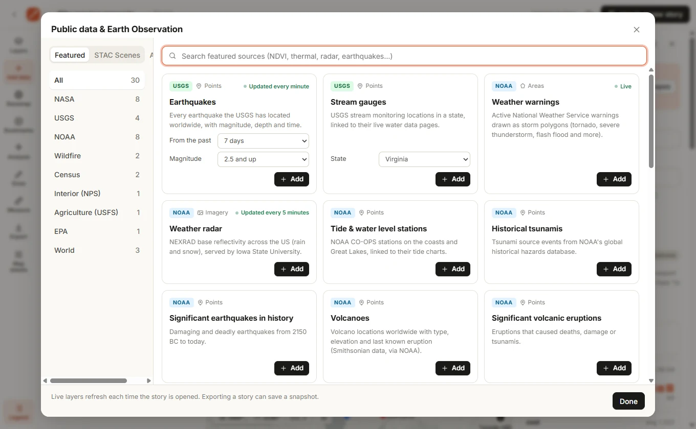

# Add data

Data comes into Waymark as **layers**. You can add a layer in the story editor's **Data** tab or the map editor's **Add data** tool. Both offer the same options:

| Source | Best for |
| --- | --- |
| [Public data catalog](#public-data-catalog) | Live and reference data from USGS, NOAA, NASA, the Census Bureau and more, plus Sentinel-2 satellite scenes and ArcGIS Online. |
| [Files](#files) | GeoJSON, zipped shapefiles, GeoPackages, KML, GPX, CSV and geotagged photos. |
| [Links](#links) | GeoJSON on the web and public ArcGIS feature layers. |
| [Map services](#map-services) | WMS, WMTS and WFS services, map tiles and PMTiles files from other servers. |
| [Hosted layers](#hosted-layers) | Data stored on your Waymark server that many maps can share. |
| [Drawing](#drawing) | Shapes and labels you sketch yourself. |

After a layer is added, open it to style it, filter it and set its popups. See [Style and configure layers](layer-settings.md).

## Public data catalog

Select **Browse public data** (story editor) or **Browse public data** in **Add data** (map editor).

The catalog has three tabs:

- **Featured**: ready-made layers. Some have options, such as the time period and minimum magnitude for earthquakes, or the state for stream gauges. Live layers refresh each time the story or map is opened.
- **STAC Scenes**: Copernicus Sentinel-2 satellite scenes for the area on screen, with a **Max cloud cover** filter. Add a scene to show it as imagery at 10 m detail.
- **ArcGIS**: search public layers on ArcGIS Online by topic or place ("flood zones", "hospitals", "bike lanes"). If a service has several layers, pick one.

### Featured layers

| Provider | Layers |
| --- | --- |
| USGS | Earthquakes (live, updated every minute), Stream gauges, 3D LiDAR / DEM shaded relief, National Hydrography |
| NOAA | Weather warnings (live), Weather radar (every 5 minutes), Tide and water level stations, Historical tsunamis, Significant earthquakes in history, Volcanoes, Significant volcanic eruptions, Tectonic plate boundaries |
| NASA | Natural events happening now (daily), Satellite image of the day, NDVI vegetation health, False-color infrared, Sea surface temperature, Smoke, dust and aerosols, Snow and ice cover, Earth at night |
| Census Bureau | States, Counties |
| Interior and Agriculture | National parks, National forests |
| EPA | Superfund sites |
| Wildfire (NIFC) | Active wildfires (live), Wildfire perimeters (live) |
| World (Natural Earth) | Countries, Major cities, Rivers and lakes |

Each layer comes styled and credited. Change anything in its settings.

> [!NOTE]
> Imagery layers (radar, satellite, NDVI and so on) are pictures, not features: you can show them and set their opacity and date, but not filter or analyze them.

## Files

Select **Your data** (story editor) or **Your data** in **Add data** (map editor), then drop files or click to browse. You can also drag files straight onto the story editor.

| Format | Notes |
| --- | --- |
| **GeoJSON** (`.geojson`, `.json`) | Points, lines and areas with attributes. |
| **Zipped shapefile** (`.zip`) | A zip containing at least the `.shp`; include the `.dbf` for attributes and the `.prj` for the coordinate system. A zip with several shapefiles becomes several layers. |
| **GeoPackage** (`.gpkg`) | Each feature table becomes a layer. |
| **KML** (`.kml`) | Google Earth placemarks, lines, areas, folders and extended data. |
| **GPX** (`.gpx`) | GPS waypoints, tracks and routes, with distance and elevation statistics. |
| **CSV** (`.csv`) | A table with latitude and longitude columns named `lat`, `latitude`, `lat_dd` or `y`, and `lon`, `lng`, `long`, `longitude`, `lon_dd` or `x` (any capitalization). Rows without coordinates are skipped. |
| **Photos** (`.jpg`) | Geotagged photos become a point layer; each popup shows the photo. |

**Where your file is stored.** Small files are stored inside the story or map. Files over 3 MB or 20,000 features are uploaded and stored as a [hosted layer](hosted-layers.md) instead, so the story stays fast; layers over 20,000 features are then drawn from vector tiles. GeoPackages always become hosted layers. The largest upload is 256 MB unless your administrator changed it.

**Coordinate systems.** Waymark converts WGS 84, NAD83 and ETRS89 (longitude and latitude), Web Mercator, and UTM zones (WGS 84, NAD83, ETRS89) automatically. Shapefiles in other Transverse Mercator systems are converted from their `.prj` too. Files in other systems, such as Lambert State Plane zones, are refused with a message; re-save them as WGS 84 (EPSG:4326) in your GIS software first. See [Data formats and limits](formats.md).

## Links

Paste a link under **Or add by link** to load data from the web each time the story or map opens.

- **GeoJSON** at any address that allows other websites to read it. Paged results from OGC API Features services are followed automatically, up to 20,000 features.
- **ArcGIS feature layers**: an address ending in `/FeatureServer/0` or `/MapServer/0` (any layer number). Waymark pages through the service, up to 20,000 features.

> [!TIP]
> To keep a copy that updates on a schedule instead of on every view, make a hosted layer and set it to follow the link. See [Keep a layer in sync with a URL](hosted-layers.md#keep-a-layer-in-sync-with-a-url).

## Map services

Select **From a map service**, paste an address and select **Look up**. Waymark asks the server what it offers and lists its layers. Select a layer to add it.

| You paste | You get |
| --- | --- |
| A **WMS** service address | Imagery layers drawn by the server. |
| A **WMTS** service address | Imagery layers from map tiles (Web Mercator tile sets only). |
| A **WFS** service address | Feature layers (up to 20,000 features) that you can style, filter and analyze. |
| A tile address with `{z}/{x}/{y}` | An imagery layer, or for `.pbf`/`.mvt` addresses a vector tile layer (you're asked for the layer name inside the tiles). |
| A `.pmtiles` file address | A vector or imagery layer read straight from the file. |

Use the **Try** buttons to see examples (USGS topo, NASA GIBS, OpenStreetMap). If a server doesn't let browsers read its description directly, Waymark fetches it through your Waymark server.

## Hosted layers

Select **Hosted feature layers** to add one of your hosted layers (or one shared with you), or **New hosted layer** to create an empty one with fields you define. See [Hosted layers](hosted-layers.md).

## Drawing

Select **Draw** to sketch points, lines, freehand lines, areas, boxes, circles and text labels. See [Draw and measure](draw-measure.md).

## Sample data

In the story editor, **Try sample data** adds landmarks along the Potomac River, ready to style.

## Remove a layer

- **Story editor:** open the layer in the **Data** tab and delete it. Maps that showed it stop showing it.
- **Map editor:** **Remove** in the layer's **⋯** menu, with **Undo** for a few seconds.

Removing a layer from a story or map never deletes a hosted layer; that only happens from the **Layers** tab.
