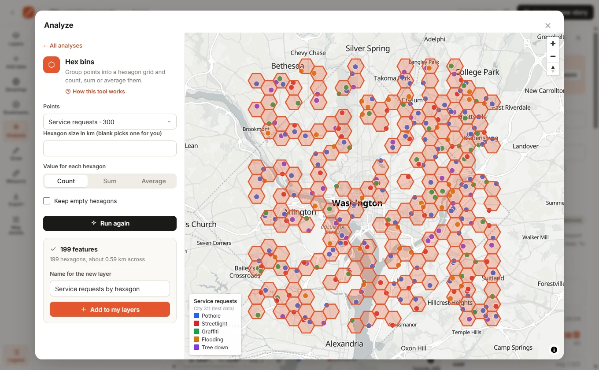

# Analysis overview

Analysis answers spatial questions about your layers: what's near what, what falls inside what, where things cluster, how far you can travel, what you can see from a hill. Each analysis makes a **new layer** that you can style, chart, put in a story or analyze further. Your original layers are never changed.

## Run an analysis

1. Open the analysis tools:
   - **Story editor:** **Data** tab → **Analyze**, or **Analyze** under a layer's Insights.
   - **Map editor:** **Analysis** in the tool rail.
   - Or press <kbd>Ctrl</kbd>+<kbd>K</kbd> and type the tool's name.
2. Pick a tool. Tools are grouped into **Summarize**, **Proximity**, **Overlay**, **Terrain** and **Manage data**.
3. Choose the input layers. Only layers with the right kind of features are offered; for example, Count in areas needs an area layer and a point layer.
4. Set the options, such as a distance and units.
5. Select **Run**. The result appears on the map in orange, with a summary such as "212 features" and often a note explaining the result.
6. Change options and **Run again** until it looks right.
7. Name the result and select **Add to my layers**.

The new layer gets a sensible style, and in the story editor it's ready to turn on in any map with **Edit map**.

> [!TIP]
> If the input layer has filters, the analysis uses only the features that pass them, and the layer list says "(filtered)". Filter first to analyze a subset, such as earthquakes of magnitude 5 or more.

## Re-run an analysis

A result remembers the tool, the inputs and the options. When the input data changes, for example a live feed updates or you edit a hosted layer, open the result's settings and select **Re-run** (story editor) or **Re-run analysis** in its menu (map editor). The result is recalculated with the latest data and keeps its style.

## Where analysis runs

Most tools run in your browser, which keeps your data private and needs no setup, but limits how much data a tool can handle at once. When a layer is too big, the tool says so; filter it first, or use a smaller area. Typical limits:

| Tool | Most it handles |
| --- | --- |
| Buffer | 5,000 features |
| Multi-ring trade areas | 1,000 sites |
| Spatial density clusters | 15,000 points |
| Hex bins | 200,000 points |
| Dissolve | 20,000 shapes |
| Voronoi areas | 20,000 points |
| Elevation profile & slope | 2,000 features |
| Route along roads | 20 stops |
| Travel-time areas | 10 starting points |

Three tools use outside services:

| Tools | Service |
| --- | --- |
| Route along roads, Travel-time areas | A Valhalla routing server, using OpenStreetMap roads and paths. By default this is a free public server for light use; your administrator can set up your own. Travel times are for typical conditions, without live traffic. |
| Elevation profile & slope, Cost surface, Least-cost path, 3D viewshed | Free global elevation data (Mapzen Terrarium tiles on AWS Open Data, combining SRTM, USGS 3DEP and others). |

Big layers drawn from vector tiles and imagery layers can't be used as analysis inputs. See [Big layers](hosted-layers.md#big-layers).

## Distances and units

Distance options accept **kilometers**, **miles** or **meters**. Distances are measured along the earth's surface (great-circle distance), so they're accurate anywhere in the world. Areas are in square kilometres and are added as fields such as `area_km2`.

## Choose the right tool

| Question | Tool |
| --- | --- |
| How many points fall in each area? | [Count in areas](analysis-tools.md#count-in-areas) |
| Where are points concentrated? | [Hex bins](analysis-tools.md#hex-bins), [Spatial density clusters](analysis-tools.md#spatial-density-clusters), [Hot-spot & outlier analysis](analysis-tools.md#hot-spot--outlier-analysis) |
| Are high values clustered in a statistically significant way? | [Hot-spot & outlier analysis](analysis-tools.md#hot-spot--outlier-analysis) |
| What's within 1 km of a school? | [Buffer](analysis-tools.md#buffer), [Within distance](analysis-tools.md#within-distance) |
| How far is each home from the nearest clinic? | [Distance to nearest](analysis-tools.md#distance-to-nearest), [Hub & spoke desire lines](analysis-tools.md#hub--spoke-desire-lines) |
| How far can I drive in 15 minutes? | [Travel-time areas](analysis-tools.md#travel-time-areas) |
| What's the road route between these places? | [Route along roads](analysis-tools.md#route-along-roads) |
| Which store will customers choose? | [Gravity & Huff market share model](analysis-tools.md#gravity--huff-market-share-model) |
| Which areas does each site serve? | [Voronoi areas](analysis-tools.md#voronoi-areas), [Multi-ring trade areas](analysis-tools.md#multi-ring-trade-areas) |
| Keep only what's inside the city limits | [Clip](analysis-tools.md#clip), [Select by location](analysis-tools.md#select-by-location) |
| Remove what's inside a protected area | [Erase](analysis-tools.md#erase) |
| Which district is each point in? | [Join by location](analysis-tools.md#join-by-location) |
| Add census figures to my tracts by ID | [Join attributes by field](analysis-tools.md#join-attributes-by-field) |
| Merge counties into regions | [Dissolve](analysis-tools.md#dissolve) |
| How steep is this trail? | [Elevation profile & slope](analysis-tools.md#elevation-profile--slope) |
| What can be seen from this tower? | [3D viewshed & line of sight](analysis-tools.md#3d-viewshed--line-of-sight) |
| What's the easiest path across rough terrain? | [Least-cost path & corridor](analysis-tools.md#least-cost-path--corridor) |

See every tool in the [Analysis tool reference](analysis-tools.md).
