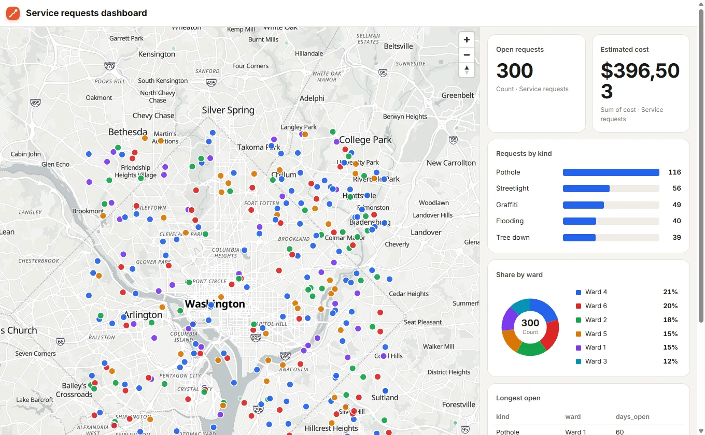

# Dashboards

A dashboard puts one of your saved maps beside big numbers, bar charts, donuts and tables made from its layers. Everything is linked: click a bar or a slice and the map and every other chart filter to match. Dashboards are good for monitoring (open requests, active incidents, inspections due) and for presenting a data set at a glance.

## Create a dashboard

1. Make sure you have a [saved map](map-editor.md) with the layers you want to chart.
2. On the **Dashboards** tab, select **New dashboard**, and pick the map. Or, on the **Maps** tab, choose **New dashboard with this map** from the map's **⋯** menu.
3. The dashboard opens with the **Add a chart** dialog.

## Add charts

1. Select **Add a chart**.
2. Choose the **Kind of chart**:

   | Kind | Shows |
   | --- | --- |
   | **Big number** | One figure, such as the count of open requests or the total cost. |
   | **Bar chart** | One bar per value of a field, longest first. |
   | **Donut** | Shares of a whole, one slice per value (up to six, with the rest as "Other"). |
   | **Table** | Rows of features with the columns you choose. |

3. Give it a **Title**.
4. Choose the **Layer** from the map.
5. For bar charts and donuts, choose **One bar or slice for each**: the field to group by, such as `kind` or `ward`.
6. Choose what to **Show**: **Count**, **Sum**, **Average**, **Smallest** or **Largest**, and for anything but Count the number field to use.
7. For big numbers, optionally add text **Before the number** (such as `$`) and **After the number** (such as `%`).
8. For tables, list the **Columns** and optionally **Biggest first, by** a number field, and **Rows to show**.
9. Select **Add chart**.

Big numbers sit side by side; other charts take the full width of the panel.

**To change a chart**, open its **⋯** menu and choose **Edit**, **Move up**, **Move down** or **Delete**.

## Filter by clicking

- **Click a bar** in a bar chart, or a **slice or legend entry** in a donut, to filter to that value. The map shows only matching features, and every other chart on the same layer recalculates. A chip at the top of the panel says what's selected.
- **Click it again**, or the **×** on the chip, to clear the filter.
- **Click a table row** to highlight that feature on the map and zoom to it.

## Only what's in view

Tick **Only what's in view** in the top bar to make the charts count only the features inside the map's current view. Pan and zoom the map, and the numbers follow. This setting is saved with the dashboard, so readers get it too.

## Change the map

The dashboard uses the saved map live: its layers, styles and basemap. To change them, select **Edit the map** in the top bar, which opens the map editor. Charts on a layer that's removed from the map show a message instead.

## Share a dashboard

Select **Share** in the top bar (or **Share…** in the dashboard's menu on the home screen):

- Share it with people or groups as viewers or editors. Editors can add and change charts.
- Turn on **Anyone with the link can view this dashboard** for a public page at `/d/<id>`, and copy the embed code to put it in a website.

See [Sharing and teams](sharing.md). Viewers and the public can click to filter, but can't change the dashboard.

## Duplicate or delete

From the dashboard's **⋯** menu on the home screen: **Duplicate** makes a copy using the same map; **Delete** removes the dashboard (the map isn't deleted).

## Tips

- Charts work on the features each layer shows, after its filters. Filter a layer in the map editor to chart a subset.
- Dashboards load each layer whole in the browser, so very large layers (drawn from vector tiles) can't be charted. Use a summary layer instead, such as [Hex bins](analysis-tools.md#hex-bins) or [Count in areas](analysis-tools.md#count-in-areas).
- For a live dashboard, use hosted layers that [stay in sync with a URL](hosted-layers.md#keep-a-layer-in-sync-with-a-url) or that collect points through a [form](forms.md).
