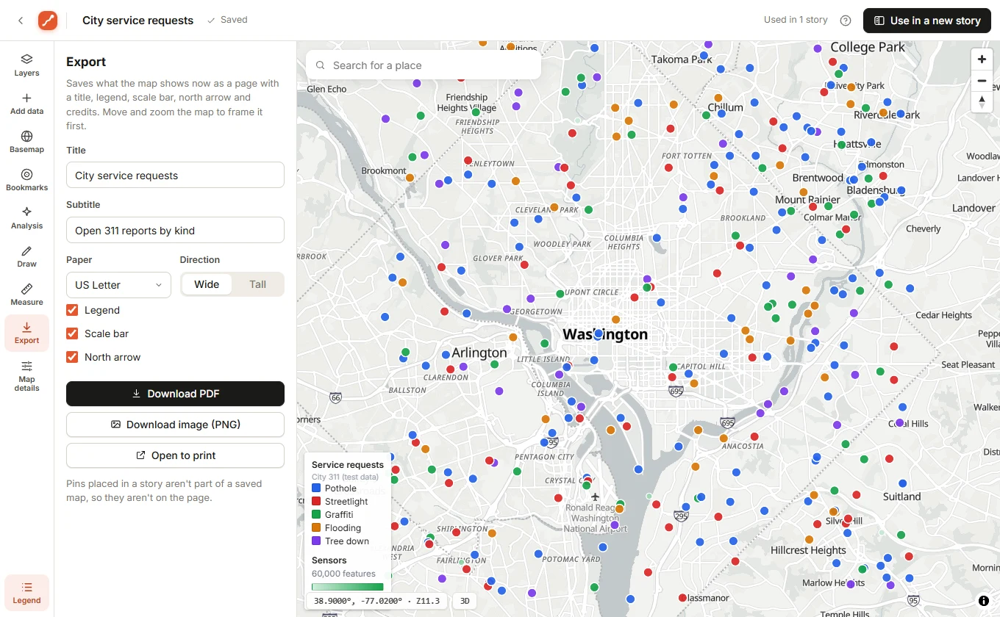

# Export and print

Take your work out of Waymark: as a website you can host anywhere, as a printable map, or as data.

## Export a story as a website

Download a complete copy of a story that runs on any web server, with no Waymark needed. Use it to host a story on your organization's own website, archive it, or put it on a server without internet access.

1. Open the story's **⋯** menu (in the editor or on the home screen) and choose **Export as a website…**.
2. Choose a **Format**:
   - **Website folder (.zip)**: for Apache, nginx, IIS, Amazon S3, GitHub Pages, any static host, or just opening on your computer.
   - **Tomcat web app (.war)**: copy it into Tomcat's `webapps` folder and it's served automatically.
3. Choose the **Version**: the **Published version** or the **Current draft**.
4. Choose what to **Include**:
   - **Copy images into the export**: uploaded images are always included; this also copies images linked from other websites, where they allow it.
   - **Save a copy of linked map data**: layers keep working even if the original source changes or goes offline. Turn it off to keep live feeds live.
   - **Include the map library** (about 800 KB): without it, the exported site loads the map library from the internet.
5. Select **Download**. Waymark shows each step and any warnings, such as an image that couldn't be copied.

**What's in the export:** the story with its text, images, maps, layers and scroll effects, and any saved maps it uses (as a copy). The exported site doesn't change when you edit the story or its maps; export again to update it. Basemaps still load from the internet.

> [!NOTE]
> Big hosted layers are exported as files rather than tiles. A layer with hundreds of thousands of features makes a large, slow export; consider filtering it or summarizing it first.

To host a `.zip` export, unzip it and upload the folder to your web server. Opening `index.html` straight from your computer also works.

## Print or export a map

The map editor's **Export** tool saves the map as a page with a title, legend, scale bar, north arrow and credits.

1. Open the map in the [map editor](map-editor.md).
2. Pan and zoom to frame exactly what you want, and switch on the layers to include.
3. Select **Export** in the tool rail.
4. Set the **Title** and **Subtitle** (they start as the map's title and summary).
5. Choose the **Paper** (**US Letter**, **A4** or **Tabloid / A3**) and **Direction** (**Wide** or **Tall**).
6. Choose whether to include the **Legend**, **Scale bar** and **North arrow**.
7. Select one of:
   - **Download PDF**: a one-page PDF at 150 dots per inch, ready to print or attach.
   - **Download image (PNG)**: the same page as an image, for slides and documents.
   - **Open to print**: opens the PDF in a new tab, where you can print it.

The map fills the frame from its center, so the middle of your screen is the middle of the page. Credits for the basemap and every visible layer are printed under the map.

> [!TIP]
> The scale bar is accurate for the center of the map. On maps of large areas (a continent or the world), distances change across the map, so the scale bar is only a guide.

## Download data

| What | How |
| --- | --- |
| A hosted layer, or any layer's current data | Open its attribute table and select **GeoJSON** or **CSV**. |
| An earlier version of a hosted layer | **Version history…** → **Download**. See [Version history](hosted-layers.md#version-history). |
| A hosted layer as a live service | Make it public and copy its GeoJSON address. See [Public links](sharing.md#public-links). |
| A story, to import later or into another Waymark | Story **⋯** menu → **Download story file**. |

## Import a story file

In the story editor's **⋯** menu, **Import a story file…** loads a `.waymark.json` file into the open story, replacing its content. To import into a new story, create a blank story first.
