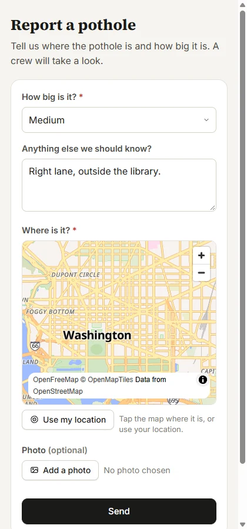

# Forms

A form is a public page where anyone with the link can add a point to one of your hosted layers: they answer your questions, mark the place on a map or use their phone's location, and can add a photo. Each submission becomes a feature in the layer, and appears in every map, story and dashboard that uses it.

Use forms for community reporting (potholes, sightings, broken streetlights), field data collection by a team, or gathering stories tied to places.

## Create a form

1. Forms add points, so you need a **point** hosted layer, or an empty one. Make one with **New hosted layer** on the **Layers** tab if needed. See [Hosted layers](hosted-layers.md#create-a-hosted-layer).
2. On the **Layers** tab, open the layer's **⋯** menu and choose **Collect data with a form…**.
3. Select **New form**. The form starts with a question for each of the layer's fields (up to 12), which you can change or remove.
4. Set up the form:

   | Setting | What it does |
   | --- | --- |
   | **Title** | Shown at the top of the form. |
   | **Introduction** | What you're collecting and why. |
   | **Questions** | Each question saves its answer in a field of the layer. For each, set the question text, the **answer type** (**Text**, **Number**, **Yes / no** or **Date**), whether it's **Required**, and optionally **Choices** (comma-separated) to make it a pick list. **Add a question** adds a new field to the layer. |
   | **People must mark the place on the map** | Turn off to make the location optional. |
   | **Let people add a photo** | Adds a photo button. Photos are shrunk and their location data is removed before upload. The photo shows in the feature's popup. |
   | **Message after sending** | Such as "Thanks! A crew will take a look." |

5. Select **Make form**. The form's link is copied for you.

## Share the form

From **Collect data with a form…**, each form has **Copy link** and **Open**. Share the link by email, on social media, on a poster as a QR code, or embedded in your website. Anyone with the link can submit; they don't need an account.

The form shows only your questions and a map. People filling it in can't see the layer's other data.

## What people see

1. The title, introduction and questions.
2. A map: they tap where it is, or select **Use my location** (their browser asks permission first). They can drag the pin to adjust it.
3. **Add a photo**, if you allowed photos. On phones this can open the camera.
4. **Send**. Required questions and the location are checked first. Then they see your thank-you message and can **Send another**.

Forms work on phones, tablets and computers.

## Review submissions

- Each submission is a new feature in the layer, with the answers in their fields, `photo_url` if a photo was added, and `submitted_at` (the date and time it was sent).
- Open the layer's **attribute table** to see and edit submissions. See [The attribute table](hosted-layers.md#the-attribute-table).
- The layer's **Version history** lists each submission as "Form: <title>", so any submission can be undone. See [Version history](hosted-layers.md#version-history).
- The form's list shows how many submissions it has received.

## Close, edit or delete a form

From **Collect data with a form…**:
- **Close** stops new submissions; people who open the link see that the form is closed. **Reopen** starts it again.
- **Edit** changes the questions and settings. Answers already received stay as they are.
- **Delete** removes the form and its link. Submissions already received stay in the layer.

## Limits and safety

- Each internet address can submit up to 30 times in 10 minutes, and upload up to 20 photos, which stops floods of spam.
- Answers are checked against the questions: numbers must be numbers, choices must be one of the choices, and required questions must be answered. Extra fields are ignored.
- Text answers are limited to 4,000 characters, and photos to 8 MB.

> [!TIP]
> For an internal team, share the layer with your group as editors and use a form for quick field entry. Close the form when the collection period ends.
