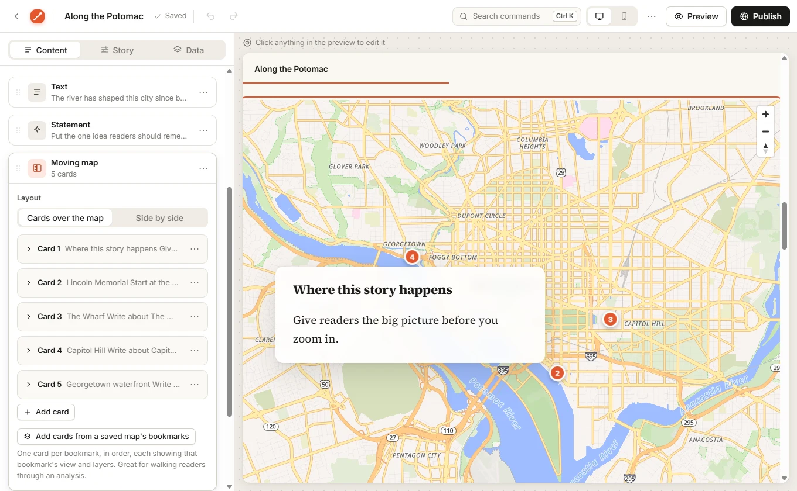

# Quick start

This walkthrough takes you from a new account to a published story with a map. It takes about ten minutes.

## Sign in

1. Open your Waymark address in a web browser. If someone else runs Waymark for you, they'll give you the address.
2. Choose **Create an account**, and enter your name, email and a password of at least 8 characters. If sign-ups are closed, ask your administrator to create an account for you.
3. You arrive on the home screen.

Waymark works in current versions of Chrome, Edge, Firefox and Safari, on desktop and on phones. Editing is easiest on a computer.

## The home screen

The home screen has five tabs:

| Tab | What's there |
| --- | --- |
| **Stories** | Your stories, and stories other people shared with you. Drafts and published stories are labeled. |
| **Maps** | Saved maps: maps you build once and reuse. See [The map editor](map-editor.md). |
| **Layers** | Hosted layers: data stored on the server. See [Hosted layers](hosted-layers.md). |
| **Dashboards** | Maps with charts and numbers. See [Dashboards](dashboards.md). |
| **Team** | Groups of people you share with. See [Sharing and teams](sharing.md). |

Every card has a **⋯** menu with actions such as Edit, Share, Duplicate and Delete. The circle with your initial (top right) opens your account menu: **Help**, **Your public page**, **Change password** and **Sign out**.

## Make a story with the wizard

1. On the **Stories** tab, select **New story**. The wizard opens.
2. **Pick a kind of story.**
   - **A journey**: the map glides from place to place as readers scroll.
   - **A walking tour**: numbered stops that readers step through, each with a photo.
   - **An illustrated essay**: full-screen chapters, big type and photos. Maps are optional.
   - **A data story**: one big map of live or uploaded data, with numbers and context.
   - **Start from scratch**: just a title and an empty page.
3. **Pick a look.** A look sets the typefaces, colors, chapter colors, map style and scroll animation. You can change it later. See [Looks](stories.md#looks).
4. **Give it a title**, and optionally a subtitle, an author name and a cover photo.
5. **Add your places** (for a journey or tour): search for each place, or click the map. For an essay, type your chapter titles instead.
6. **Choose extras** if you want them: a big statement, big numbers, a photo gallery or a quote.
7. Select **Create my story**. Waymark builds the story and opens the editor.

The story contains short prompts, such as "Open with a sentence or two that makes people want to keep reading", where your words go. Nothing is copied from an example, so there's no demo content to delete.

> [!TIP]
> Prefer to learn from something finished? On the first wizard screen, choose **Explore an example** to open a complete sample story you can take apart.

## Edit your story

The editor has the panel on the left and a live preview on the right.

1. **Click anything in the preview** to edit it. Its settings open in the panel.
2. **Replace the prompts** with your own words. The **Finish your story** checklist at the top of the panel counts the placeholder text that's left and lists other steps, such as adding photos and checking the story on a phone. Click a step to jump to it.
3. **Add a block**: select **+** between blocks, or press <kbd>/</kbd>. Choose from text, photos, maps, scroll effects and more. See the [Blocks reference](blocks.md).
4. **Set where each map goes.** Open a map block or moving-map card and select **Edit map**. Pan and zoom to frame the view, click to drop markers, choose which data layers show, then select **Use this view**. See [Maps in stories](story-maps.md).
5. **Add data** on the **Data** tab: browse public data from NOAA, NASA, USGS, the Census Bureau and others, upload a file, or draw. See [Add data](add-data.md).

Your work saves automatically as you type. The status next to the title says **Saved** when everything is stored.

## Preview and publish

1. Use the **desktop** and **phone** buttons above the preview to see the story at both sizes, or select **Preview** to open it in a new tab.
2. Select **Publish**. Choose the end of the link (for example `my-first-story`), then select **Publish** again.
3. Copy the link and share it. Anyone with the link can read the story.

After publishing you can keep editing. Readers don't see your changes until you select **Publish** again, which updates the live story. See [Publish and update](publish.md).

## Next steps

- Learn the editor in depth: [The story editor](stories.md).
- Build a reusable map with analysis and bookmarks: [The map editor](map-editor.md).
- Share your work with colleagues: [Sharing and teams](sharing.md).
