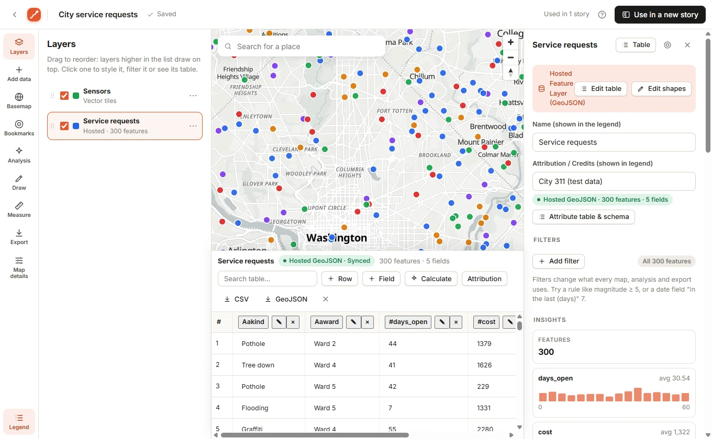

# Hosted layers

A hosted layer is data stored on your Waymark server rather than inside one story or map. Use hosted layers when you want to:

- reuse the same data in several maps, stories and dashboards, and update it in one place;
- edit attributes in a table, add fields and calculate values;
- keep a history of changes and undo them;
- refresh the data automatically from a source on the web;
- collect points from the public with a [form](forms.md);
- work with large data: layers over 20,000 features are drawn from vector tiles;
- share the data with your team, or publish it as a GeoJSON service.

Your hosted layers are on the **Layers** tab of the home screen.

## Create a hosted layer

There are four ways:

| Way | How |
| --- | --- |
| **Upload a file** | On the **Layers** tab, select **Upload a file** and choose GeoJSON, a zipped shapefile or a GeoPackage. A GeoPackage with several tables makes several layers. Large files you add to a story or map are uploaded as hosted layers automatically. |
| **Start empty** | Select **New hosted layer**. Give it a title, choose points, lines or polygons, and define its fields (name and type), or start from a template: **Site Selection & Commercial Real Estate**, **Field Asset & Infrastructure Inspection** or **Sales Territories & Trade Zones**. |
| **Publish an existing layer** | In a layer's settings in a story or map, select **Publish as Hosted Layer**. The layer's data moves to the server and the story or map now uses the hosted copy. |
| **From analysis or drawing** | Any analysis result or drawing can be published the same way. |

## Use a hosted layer in a map or story

- **Story editor:** **Data** tab → **Hosted feature layers**, then pick the layer.
- **Map editor:** **Add data** → **Hosted feature layers**.
- **Home screen:** the layer's **⋯** menu → **Open in a new map**.

The map uses the layer by reference, so edits to the hosted layer show up everywhere it's used. Each map can still style it differently.

## The attribute table

Open the table from the layer's card on the **Layers** tab (click it), from **Attribute table & schema** in a layer's settings, or from a layer's **⋯** menu in the map editor.

| To… | Do this |
| --- | --- |
| Edit a value | Click the cell and type. Changes save automatically. |
| Sort | Click a column heading; click again to reverse. |
| Search | Type in **Search table…** to show matching rows. |
| See a feature on the map | Click the row number. The map zooms to it. |
| Add a row | Select **+ Row**. In the map editor the new feature is placed at the center of the map; fill in its values, and use **Edit shapes** to move it. |
| Delete a row | Select its **Delete feature row** button. |
| Add a field | Select **+ Field**. Give it a name, a type (**Text**, **Number**, **Date** or **Yes / No**) and an optional default value. |
| Rename or delete a field | Use the **✎** and **×** buttons in the column heading. Deleting a field removes its values from every feature. |
| See column statistics | Number columns show **Sum**, **Avg**, **Min** and **Max** in their heading. |
| Download the data | **GeoJSON** or **CSV** (CSV includes longitude and latitude of each feature's center). |
| Copy the service address | **Copy URL** copies the layer's GeoJSON address. |

> [!NOTE]
> The table opens for any layer, but only hosted layers and layers stored in the story or map can be edited. For a live feed from another site, **Make Editable** copies its current data into the story or map so you can edit it.

### Field calculator

Select **Calculate** to fill a field with computed values for every row. Choose the **Target field** (an existing field, or type a new name), then the kind of calculation:

| Calculation | What it does | Example |
| --- | --- | --- |
| **Formula / Expression** | Any arithmetic using field names in braces and the special values below. | `{revenue} - {rent}` |
| **Math between fields** | Field A `+` `−` `×` `÷` field B or a number, **% of** (A ÷ B × 100) or **% change** ((A − B) ÷ B × 100). | `pop_2024` % change `pop_2020` |
| **Spatial measurement** | Area (sq km, acres or sq ft), length or perimeter (km or miles), elevation, or the center's latitude or longitude. | Area (acres) |
| **Rank / Sequence** | 1 to N in row order, or ranked by a field from high to low. | Rank by `sales` |
| **Fill constant value** | The same value in every row. | `inspected` |

Special values for formulas:

| Value | Meaning |
| --- | --- |
| `$AREA_KM2`, `$AREA_ACRES` | The feature's area. |
| `$LEN_KM` | The feature's length (lines) or perimeter (areas). |
| `$LAT`, `$LON` | The latitude and longitude of the feature's center. |
| `$ELEVATION_M` | Elevation in metres, from the feature's own height or an `elevation_m` field. (Run the [Elevation profile](analysis-tools.md#elevation-profile--slope) tool first to add elevations from terrain data.) |
| `$ROW` | The row number, starting at 1. |

## Version history

Every change to a hosted layer's features is kept: edits in the table, drawing, form submissions, refreshes and restores. The newest 25 versions are kept.

**To see or restore a version**
1. On the **Layers** tab, open the layer's **⋯** menu and choose **Version history…**.
2. Each version shows what changed (such as "Edited", "Form: Report a pothole" or "Refreshed from its source"), the number of features, when, and who.
3. Select **Download** to save that version as GeoJSON, or **Restore** to make the layer match it.

Restoring creates a new version, so you can always go back. Renaming a layer or changing its style isn't a new version; only changes to the features are.

## Keep a layer in sync with a URL

A hosted layer can follow a source on the web, so maps and dashboards stay current without anyone opening them.

1. Open the layer's **⋯** menu and choose **Keep in sync with a URL…**.
2. Paste the **Source address**: a GeoJSON file, a CSV with latitude and longitude columns, or a public ArcGIS feature layer (ending in `/FeatureServer/0` or `/MapServer/0`).
3. Choose how often to **Refresh**: only when you press Refresh, or every 15 minutes, hour, 6 hours, day or week.
4. Select **Save and refresh now** to fetch it immediately, or **Save**.

Each refresh replaces the layer's features with what the source returns. A refresh that changes nothing doesn't make a new version. The layer card shows **In sync**, or **Sync failed** with the reason if the last attempt didn't work.

> [!WARNING]
> A refresh replaces edits made by hand. Don't sync a layer you also edit in the table.

> [!NOTE]
> Only public internet addresses can be used, unless your administrator allows addresses on your own network.

## Collect data with a form

Point layers can have forms: public pages where anyone with the link adds a point. Open the layer's **⋯** menu and choose **Collect data with a form…**. See [Forms](forms.md).

## Big layers

Hosted layers with more than 20,000 features are drawn from **vector tiles** that the server makes on demand, so the browser only downloads the part of the map on screen. This keeps maps fast with hundreds of thousands or millions of features. The layer's card shows **Tiles**.

Tiled layers support color by category or number, size by number, labels, popups, filters, heatmaps and a visible zoom range. They don't support the attribute table, drawing, clusters, the time slider, insights or analysis in the browser. To analyze a big layer, filter it, publish a smaller copy, or use a desktop GIS on the downloaded data.

Clicking a big layer's card opens it on a new map rather than in the table.

## Share a hosted layer

Open the layer's **⋯** menu and choose **Share…** to share it with people or groups as viewers or editors, or turn on **Anyone with the link can load this layer's data** to publish it as a public GeoJSON service at `/api/public/layers/<id>.geojson`. Other GIS software can read that address. See [Sharing and teams](sharing.md).

Layers used by a published story, or by a map or dashboard shared by link, become readable automatically.

## Delete a hosted layer

Open the layer's **⋯** menu and choose **Delete layer**. Waymark tells you how many stories and maps use it first. Deleting removes the data and its history permanently, and maps that used it show the layer as empty. Only the owner can delete a layer.
