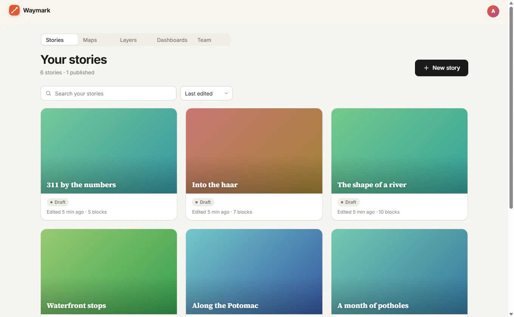

# Waymark Help

Waymark is a place to tell stories with maps. You write a story that scrolls, add maps that move as readers read, bring in live or uploaded data, analyze it, and publish it with a link. The same data can power reusable maps, dashboards and data-collection forms, and you can work on all of it with your team.

## Where to start

| If you want to… | Read |
| --- | --- |
| Make your first story in about ten minutes | [Quick start](get-started.md) |
| Understand the words this guide uses (layer, saved map, bookmark, viewer…) | [Key ideas and terms](concepts.md) |
| Learn every part of the story editor | [The story editor](stories.md) and [Blocks reference](blocks.md) |
| Put data on a map and style it | [Add data](add-data.md) and [Style and configure layers](layer-settings.md) |
| Build one map and reuse it in many stories | [The map editor](map-editor.md) |
| Find patterns in your data | [Analysis overview](analysis.md) and the [Analysis tool reference](analysis-tools.md) |
| Work with other people | [Sharing and teams](sharing.md) |
| Show numbers and charts next to a map | [Dashboards](dashboards.md) |
| Play out "what if?" on a map in a meeting | [Scenarios](scenarios.md), [Terrain, supply and combat](scenario-rules.md) for a deeper game, and [Running and reviewing a game](scenario-run.md) |
| Collect points from the public | [Forms](forms.md) |
| Print a map, or host a story somewhere else | [Export and print](export.md) |
| Install or run Waymark for your organization | [For administrators](admin.md) |

## What you can make

**Stories.** Scrolling pages that mix text, photos, video and maps. A *moving map* glides from place to place as readers scroll past story cards. *Stop by stop* steps readers through numbered places. *Before & after* compares two maps or two satellite dates with a slider. Scroll effects such as chapters that recolor the page, statements that light up word by word and numbers that count up are built in, and eight *looks* restyle a whole story in one click. See [The story editor](stories.md).

**Saved maps.** Maps you build once in a full-screen [map editor](map-editor.md), with layers, styles, analysis results and bookmarks, and then use in any number of stories. Edit the map and every story that uses it updates.

**Hosted layers.** Data stored on your Waymark server, with an editable attribute table, a field calculator, version history and an optional schedule that keeps it in sync with a source on the web. Very large layers are drawn from vector tiles so they stay fast. See [Hosted layers](hosted-layers.md).

**Analysis.** Thirty tools grouped the way desktop GIS groups them: summarize, proximity (including road routes and travel-time areas), overlay, terrain and data management. Every result previews on a map before it is saved. See [Analysis overview](analysis.md).

**Dashboards.** A saved map beside big numbers, bar charts, donuts and tables that filter each other. See [Dashboards](dashboards.md).

**Scenarios.** A tabletop exercise on a map: units for each side, moved turn by turn, with scripted events, dice, notes and branches, and a one-click write-up as a story. Add terrain, supply lines, a combat table and objectives for a deeper game. See [Scenarios](scenarios.md).

**Forms.** A phone-friendly public page where anyone with the link can add a point, with answers and a photo, to one of your layers. See [Forms](forms.md).

## How this guide is organized

- **Get started** introduces the app and its vocabulary.
- **Stories** covers writing, blocks, maps inside stories, and publishing.
- **Maps and data** covers saved maps, every way to add data, layer styling, hosted layers, and drawing.
- **Analysis** explains how analysis works and documents each tool.
- **Share and collaborate** covers teams, dashboards, forms and export.
- **Reference** collects formats and limits, keyboard shortcuts, troubleshooting, and the administrator's guide.

> [!TIP]
> Press <kbd>/</kbd> on any help page to search the whole guide.
