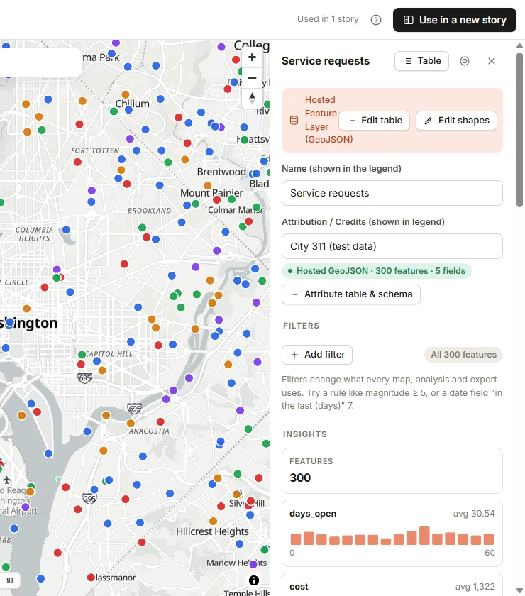

# Style and configure layers

Every layer has settings for how it looks and behaves: color, size, labels, popups, filters, time, 3D and more. The same settings appear in the story editor (**Data** tab, select a layer) and the map editor (select a layer in **Layers**).

Settings are shared by every map that shows the layer. In a story, all maps that show a layer show it the same way; in a saved map, the layer looks the same in every story that uses the map.

## Name, credits and source

| Setting | What it does |
| --- | --- |
| **Name** | Shown in the legend. |
| **Attribution / Credits** | Shown in the legend and the map's credits, such as "USGS" or "City GIS, 2026". Always credit data you didn't make. |
| **Data** | For layers from a link or file: paste a new link, or select **File** to replace the data. Catalog layers, hosted layers and analysis results show their status here instead. |

The status pill shows how many features the layer has and how many fields, or an error if the data couldn't be loaded.

Buttons under the name open the **Attribute table & schema**, **Publish as Hosted Layer** (saves the layer to the server so it can be reused and edited; see [Hosted layers](hosted-layers.md)), and for drawings and small layers **Edit shapes**.

## Filters

Filters choose which features the layer shows. They apply everywhere the layer is used: every map, every analysis, every chart, every export.

**To add a filter**
1. Under **Filters**, select **Add filter**.
2. Choose a **field**, a **rule** and a **value**. For text fields, a list of common values appears as you type. For number fields, the placeholder shows the range.
3. Add more rules if you need them. With two or more, choose whether features must match **all rules** or **any rule**.

| Rule | Keeps features where the field… |
| --- | --- |
| `=` and `≠` | equals, or doesn't equal, the value. Numbers compare as numbers; dates like `2024-05-01` compare as dates. |
| `>` `≥` `<` `≤` | is greater or less than the value. |
| **contains** | includes the text (any capitalization). |
| **in the last (days)** | is a date or time within that many days of now, such as earthquakes in the last 7 days. |
| **is empty** / **is not empty** | has no value, or has one. |

The count beside **Add filter** shows how many features match, such as "Showing 212 of 1,480". Remove a rule with its **×**.

## Insights

**Insights** summarize what the layer shows (after filters): the number of features, total area or length, a small histogram and range for each number field, and the most common values of text fields. Three buttons put this to work:

- **Add as big numbers** adds a Big numbers block to the story.
- **Add chart to story** adds a chart grouped by the layer's main category field.
- **Analyze** opens the analysis tools with this layer chosen.

## Style

### Show points as
For point layers:

| Option | Result |
| --- | --- |
| **Dots** | One circle per point. |
| **Heatmap** | A glow that's brightest where points are densest. Optionally **weight the heat** by a number field. Dots fade in when you zoom close. |
| **Clusters** | Nearby points are grouped into circles showing how many there are. Readers click a cluster to zoom in. |

### Color

| Mode | Result |
| --- | --- |
| **One color** | Every feature the same color. Features that carry their own colors (such as styled drawings, or GeoJSON from geojson.io) keep them. |
| **Category** | One color per value of a field, such as land use or party. The ten most common values get colors; the rest are "Other". Click any swatch under **Category colors** to change it. |
| **Number** | A ramp from light to the color you choose, by a number field, such as population. |
| **Bivariate** | Colors features by two number fields at once in a 3×3 grid (low, medium and high for each), with a matrix legend. Pick **Field A**, **Field B** and a color scheme. |

**Fill opacity**, **Point size** and **Line width** fine-tune the look.

### Size by number (proportional symbols)
Choose a number field under **Size by number** to make bigger values bigger:

- **Points** become circles whose area grows with the value, so twice the value looks twice as big. Big circles draw under small ones.
- **Areas** get a circle at their center, sized the same way.
- **Lines** get wider.

Set the **Smallest** and **Largest** size in pixels. Size works together with color, so you can color by one field and size by another. The legend shows example sizes.

For line layers, **Curve origin–destination lines as flow arcs** bends straight two-point lines into smooth arcs, which reads better for flows.

### 3D extrusion
For area layers, **Extrude areas in 3D** raises each area into a prism. Pick a number field under **3D Height based on field** to make taller areas for bigger values, and set the **Max height** in metres. Tilt the map to see it (<kbd>Ctrl</kbd>-drag, or the **3D** button).

## Time

Choose a date or time field under **Time field** to add a **time slider** to every map that shows the layer. Fields that look like dates are listed first. Values can be dates (`2024-05-01`), date-times, or epoch milliseconds.

The slider has a play button, and a menu to show **Everything up to** the chosen moment, or only **the day**, **the week** or **the 30 days before** it. Readers can scrub and play. Every map view and bookmark remembers the slider's setting.

## Labels and visibility

| Setting | What it does |
| --- | --- |
| **Show labels from** | Writes a field's value next to each feature. On dark and satellite basemaps, labels are light with a dark outline. |
| **Visible from zoom** / **Up to zoom** | Hides the layer when zoomed out past, or in beyond, these levels. Zoom 3 shows a continent; zoom 10 a city; zoom 16 a street. Leave blank to always show it. |

## Popup

What readers see when they click a feature.

| Setting | What it does |
| --- | --- |
| **Popup title** | Text with field names in braces, such as `{NAME}` or `{kind} in {ward}`. |
| **Fields to list** | Field names separated by commas. Leave blank to show the first few fields. |

A field named `description` is shown as a paragraph, and a field named `photo_url` is shown as a photo at the top of the popup.

## Per-feature styles

Features can carry their own style in their attributes, using the simplestyle convention that geojson.io and many tools write: `stroke`, `stroke-width`, `stroke-opacity`, `fill`, `fill-opacity`, `marker-color` and `marker-size` (`small`, `medium` or `large`). Waymark adds `stroke-dash` (`solid`, `dashed` or `dotted`), `arrow` (an arrowhead at the end of a line) and `text` (a point drawn as a text label, sized by `text-size`). Drawings use these automatically. They apply when the layer's color mode is **One color**.

## Imagery layers

Imagery layers (radar, satellite, WMS, WMTS and similar) have fewer settings: **Name**, **Attribution**, **Opacity** (0 to 1), and for daily imagery a **Date** (blank means yesterday's image, which is usually the latest complete one).

## Big layers drawn from tiles

Layers with more than 20,000 features, and vector tile layers from other servers, are drawn from tiles. They support colors (one color, category, number), size by number, labels, popups, filters, heatmaps and a visible zoom range. The attribute table, drawing, clusters, the time slider, insights and analysis need a layer that's loaded whole. Colors and legends are worked out from a sample of 5,000 features, so with very many categories, rare values may be grouped as "Other". See [Big layers](hosted-layers.md#big-layers).

## Basemaps

The basemap is the background under your data. Each map view chooses its own.

| Basemap | Good for |
| --- | --- |
| **Streets** | General use, with roads, places and buildings. |
| **Bright** | A colorful street map. |
| **Light gray** | Data-heavy maps: quiet gray lets your data stand out. |
| **Dark** | Glowing data, night themes. |
| **Satellite** | Sentinel-2 cloudless imagery of the whole world (about 10 m detail). |
| **USGS imagery** | Detailed aerial photos of the United States. |
| **USGS topo** | U.S. topographic maps with contours. |

The street, light and dark basemaps come from OpenFreeMap (OpenStreetMap data). A story's [look](stories.md#looks) sets the default basemap for new maps.

## The legend

Each map has a legend listing its visible layers with their colors, categories, ramps, sizes and credits. Turn it off per map with **Show legend** (story maps) or **Legend** in the tool rail (map editor). Big layers show their feature count in the legend.
