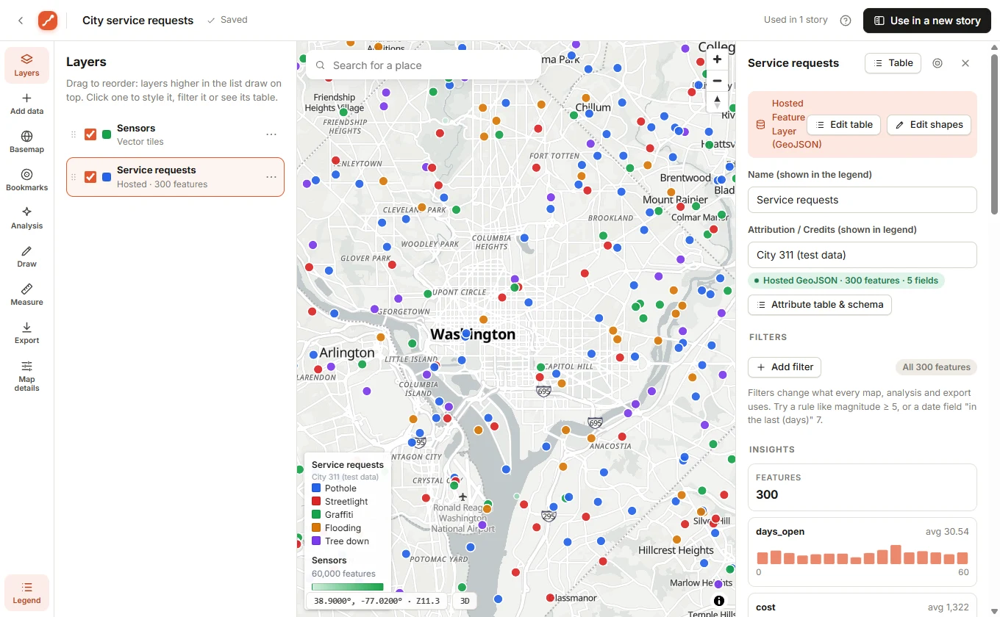

# The map editor

The map editor is a full-screen workspace for building a **saved map**: a map you make once and use in any number of stories and dashboards. Edit it once, and everything that uses it updates, published stories included.

## Create or open a map

- **New map:** on the **Maps** tab, select **New map**.
- **Open a map:** click its card.
- **From a hosted layer:** on the **Layers** tab, use **Open in a new map** in the layer's menu.

## Parts of the map editor

| Part | What it does |
| --- | --- |
| **Top bar** | Back to your maps, the map's title (click to rename), save status, how many stories use the map, and **Use in a new story**. |
| **Tool rail** (left) | **Layers**, **Add data**, **Basemap**, **Bookmarks**, **Analysis**, **Draw**, **Measure**, **Export** and **Map details**. Each opens a panel. **Legend** at the bottom shows or hides the legend. |
| **Panel** | The selected tool's options. |
| **Map** | The live map, with **Search for a place**, zoom and rotation controls, the coordinates and zoom level under the pointer, and a **3D** button. |
| **Layer settings** (right) | Opens when you select a layer. See [Style and configure layers](layer-settings.md). |
| **Attribute table** (bottom) | Opens from a layer's menu. See [Attribute table](hosted-layers.md#the-attribute-table). |

Changes save automatically. If the map is changed in another tab or by a co-editor, you're offered the latest version.

## Layers

The **Layers** panel lists the map's layers in drawing order: **layers higher in the list draw on top**.

- **Show or hide** a layer with its checkbox.
- **Reorder** by dragging.
- **Select** a layer to open its settings on the right.
- The **⋯** menu on a layer has **Zoom to layer**, **Attribute table & schema**, **Settings**, **Re-run analysis** (for analysis results), **Edit shapes** (for drawings), **Duplicate** and **Remove**. Removing shows an **Undo** button.

## Add data

The **Add data** panel offers every way to bring data in: your hosted feature layers, a new hosted layer, the public data catalog, map services, your own files and links, and drawing. Each is explained in [Add data](add-data.md). New layers are switched on automatically.

## Basemap and 3D

The **Basemap** panel shows each basemap with a preview: **Streets**, **Bright**, **Light gray**, **Dark**, **Satellite**, **USGS imagery** and **USGS topo**.

It also has 3D settings:
- **3D Terrain, Hillshade & Sky**: shows real elevation worldwide, with shading and a sky at the horizon. Set the **Vertical exaggeration** to make hills more visible.
- **3D City Buildings**: extruded buildings, visible when you zoom in to street level.
- **Camera tilt**: how far the camera leans toward the horizon. You can also <kbd>Ctrl</kbd>-drag the map to tilt.

These settings are part of the map's starting view and its bookmarks.

## Bookmarks

A bookmark is a named view that also remembers which layers are on and where the time slider is, with a note. Use bookmarks to save the views you want to show, then walk readers through them in a story.

**To add a bookmark**
1. Frame the view and switch on the layers you want.
2. Open **Bookmarks** and select **Bookmark this view**.
3. Give it a name and, optionally, a note. The note becomes the card text when bookmarks are turned into story cards.

Select a bookmark to go to it. Its **Bookmark options** menu has **Update to the current view and layers**, **Move up**, **Move down** and **Delete**.

## Analysis, drawing and measuring

- **Analysis** lists all 30 tools by group. Results preview on the map before you add them. See [Analysis overview](analysis.md).
- **Draw** sketches points, lines, areas, circles and text as a new layer. See [Draw and measure](draw-measure.md).
- **Measure** gives distances and areas by clicking the map. Nothing is saved.

## Export

**Export** saves what the map shows as a page with a title, legend, scale bar, north arrow and credits, as a PDF or PNG. See [Print or export a map](export.md#print-or-export-a-map).

## Map details

| Setting | What it does |
| --- | --- |
| **Title**, **Summary** | Shown on the map's card, its public page and its link previews. |
| **Thumbnail** | The card picture. **Use the current view** captures the map as it is now. |
| **Starting view** | **Make this the starting view** saves where the map opens. Panning and zooming in the editor doesn't change it until you select this. |
| **Used in** | The stories that use this map, with a link to each. |
| **Save a copy** | Duplicates the map. |
| **Delete map** | Deletes it. Stories that used it show an empty map. |

## Use a map in stories

- **Use in a new story** (top bar) starts a story built on this map: a moving map with one card per bookmark, or one big map if there are no bookmarks.
- In any story, a Map block or moving-map card can **use a saved map**, showing a bookmark or a custom view. See [Use a saved map](story-maps.md#use-a-saved-map).
- On the home screen, a map's menu also has **New story with this map** and **New dashboard with this map**.

## Share a map

From the **Maps** tab, open the map's **⋯** menu and choose **Share…**:
- Share it with people or groups as viewers or editors.
- Turn on **Anyone with the link can view this map** to give it a public page at `/m/<id>`, with its legend, bookmarks and time slider, and an embed code.

See [Sharing and teams](sharing.md). A map is also readable by anyone who can open a story or dashboard that uses it.
