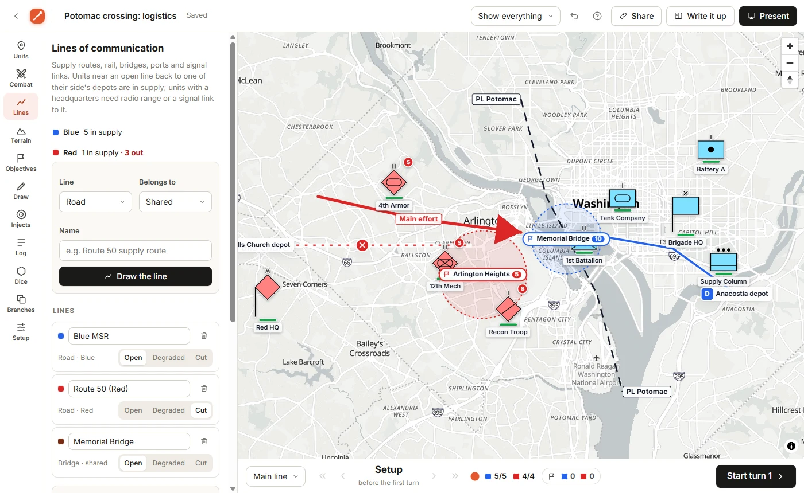

# Terrain, supply and combat

These tools make a [scenario](scenarios.md) play more like a real operation. The ground slows units down and wears them out. Supply has to reach them along lines that the other side can cut. Headquarters need to stay in contact. Fights are settled with a combat table, and objectives keep score.

Each one is optional. Use the ones your exercise needs and leave the rest out.

## Terrain

Terrain is a grid of hexes over the play area. Each hex records its ground (open, forest, built-up, water or marsh), the best road through it, whether a river crosses it, and its height. Once a scenario has terrain:

- A unit you drag moves along the **quickest route over the ground**, not a straight line. Roads are fastest; forest, marsh and steep slopes are slow; water stops land units unless there's a bridge.
- The selected unit's **outline** shows every hex it can reach this turn.
- Each move records the **time it took** and the **supply it used**, and you're warned when a move takes longer than a turn.
- Defenders in built-up areas and forest are harder to beat in [combat](#combat).
- [Automatic spotting](#spotting) checks line of sight over the hills, woods and buildings.

### Build the terrain

1. Pan and zoom the map to the play area.
2. Open **Terrain**.
3. Choose the **Cell size**. Each option shows how many hexes it makes. About 100 hexes across the area works well: 250 m for a town, 1 km for a county, 5 km for a region. The limit is 30,000 hexes.
4. Select **Build the terrain**.

Waymark reads elevation from the same open data as the analysis tools, and roads, rivers, water, forest and built-up areas from OpenStreetMap. This needs an internet connection once. The result is saved with the scenario, so the game plays offline afterward and the ground doesn't change during the game.

For cells of 2 km and larger, only main roads, rivers, lakes and towns are read, to keep the download small. Built-up areas are then estimated from city and town locations.

If part of the data couldn't be downloaded, the panel says so; select **Rebuild for this view** to try again. **Remove** takes the terrain away, and units go back to moving in straight lines.

### See the ground

Under **Show on the map**, choose:

- **Ground, roads and rivers**: each hex colored by what's there.
- **How fast**, for one kind of mobility: green is full speed, yellow and orange slower, red very slow, dark red impassable. Use it to brief the room on where armor can and can't go.

### How units move

Each unit moves in one of these ways. It's set from its kind, and you can change it under **Moves** in the unit's panel.

| Moves | Usual for | Usual speed |
| --- | --- | --- |
| **On foot** | Infantry, teams, civilians | 5 km/h |
| **Wheeled** | Reconnaissance, supply, headquarters, police, fire, ambulances | 50 km/h |
| **Tracked** | Armor, mechanized infantry, artillery, engineers | 35 km/h |
| **Amphibious** | (choose it) | 30 km/h |
| **Air** | Aircraft, helicopters, army aviation | 250 km/h |
| **Naval** | Warships, submarines | 30 km/h |
| **Doesn't move** | Shelters, hazards | — |

A unit's **Speed** is its top speed on a main road. Leave it empty to use the usual speed. How far it gets in a turn depends on **Minutes per turn** in Setup, and on the [weather and light](scenario-run.md#weather-and-daylight): rain, snow and darkness slow units off-road, and some weather grounds aircraft.

### The movement table

The movement table sets the share of top speed each kind of unit keeps on each kind of ground: 1 is full speed, 0.5 is half speed, 0 means it can't go there. A road through a hex counts instead of its ground, so a road over a river is a bridge. Off-road, slopes slow units too: steeper than about 35% stops wheels, and 60% stops tracks.

Rough ground also uses more supply: a unit moving at half speed uses twice the supply.

To change the table, select **Movement table…** in Terrain or Setup, edit the numbers, and select **Save**. **Reset to standard** puts the original values back.

### Areas

An area changes the ground inside it. Draw one for a minefield, a flooded valley, a contaminated zone, a no-go area, or a place where radios are jammed.

1. In **Terrain**, select **Draw an area**.
2. Give it a **Name** and choose its **Effect**:

   | Effect | What it does |
   | --- | --- |
   | **Slows movement** | Multiplies speed inside it, such as 0.5 for half speed. |
   | **Can't be crossed** | Nothing it affects can enter. |
   | **Uses more supply** | Multiplies the supply moves inside it use. |
   | **Jams radios** | Units inside it can't use radio to reach their headquarters. |

3. Under **Affects**, untick the kinds of mobility it doesn't apply to. For example, a minefield doesn't affect aircraft.
4. Choose when it applies: **Starts on turn** and **Ends after turn**, or **Or starts when** an inject is released. For example, "Heavy rain" can turn open ground to mud from the moment you release it.
5. Select **Draw it**, then click the corners on the map. Double-click or press `Enter` to finish.

Areas belong to the whole scenario, so each branch can trigger them at its own time. Select **Edit** to change one, **Redraw** to change its shape, or **Delete** to remove it.

## Lines of communication

Lines of communication are the routes that keep units supplied and in contact: supply routes, rail, bridges, rivers and canals, sea lanes, air routes, pipelines and signal links. Open **Lines** to add them.

### Depots and lines

Supply starts at a **depot**, **port** or **airfield** that belongs to a side. Without one, that side's supply isn't tracked at all.

1. In **Lines**, under **Place**, choose the kind and the side it **Belongs to**, and give it a **Name**.
2. Select **Place a depot, port, airfield or relay**, then click the map.

Then draw the routes from it:

1. Choose the **Line**, the side it **Belongs to** (or **Shared**, for a road both sides use), and a **Name**.
2. Select **Draw the line**, then click along the route. Each end snaps to the points of other lines and to depots nearby, so the network joins up.
3. Double-click or press `Enter` to finish.

### Supply

Every unit of a side with depots has a supply state, shown in its panel and as a small flag on its symbol:

| State | Means | Flag |
| --- | --- | --- |
| **In supply** | Within reach of one of its side's depots, or of a line joined to one by open lines. | none |
| **Supply strained** | Only reachable through a degraded line. | amber **S** |
| **Out of supply** | Nothing open reaches it. The panel says for how many turns. | red **S** |

**Supply reach** (Setup → Rules, 5 km to start with) is how far from a line or depot a unit can be and still draw supply.

Each unit also has a **supply level**, from 0 to 100%. Moves over terrain use it up. At the start of each turn, units in supply regain the **Resupply per turn** (50% to start with), strained units half that, and units out of supply nothing. A unit that can't afford a move can still make it, with a warning.

The **Lines** panel lists, for each side, how many units are in supply, strained and out.

### Cut and degraded lines

Each line and depot has a status for every turn. In **Lines**, choose **Open**, **Degraded** or **Cut** for a line, and **Open** or **Lost** for a depot. The change applies from the current turn and is written to the log. Statuses carry over to later turns until you change them.

A line can also be lost in two other ways:

- **By an inject.** In the inject, choose what **When released, it changes**. For example, "Memorial Bridge damaged" can cut the bridge line.
- **By the enemy.** An opposing unit within **Enemy units cut lines within** (Setup → Rules, 2 km to start with) of a side's own line cuts it there, and one on a depot takes it. These lines are marked with an orange **✕**, and supply works it out around the gap straight away. It opens again when the enemy moves away. Shared lines are only cut by hand or by an inject.

Cut lines are drawn as red dashes with a red **✕**; degraded lines as amber dashes.

**Bridges and the ground.** With terrain, cutting a road, rail or bridge line also takes out its crossings: where it crosses a river, the hex goes back to being a river. Wheeled units have to find another bridge, and units on foot wade across slowly. A degraded line halves the speed over its crossings.

### Command and contact

Give a unit a headquarters under **Reports to** in its panel (or with `reports_to` when [importing units](scenarios.md#import-units-from-a-spreadsheet)). It's then in contact if either:

- its headquarters is within **Radio range** (Setup → Rules, 25 km to start with), and neither of them is inside an area that jams radios, or
- both are near open **signal links** that join up, or near a **signal relay** within radio range. Signal links are wires and relays, so jamming doesn't stop them.

A unit out of contact shows a crossed-out purple **C** flag and the reason in its panel: out of range, jammed, or its headquarters is out of action. What that means for the game is up to the room. A common rule is that it keeps following its last orders.

### Supply effects

By default, being out of supply or contact is shown and logged, and the room decides what it means. Turn on **Apply supply effects** in Setup → Rules to make it automatic:

- Units out of supply lose **Strength lost per turn** (10% to start with) at the start of each turn.
- Their moves use twice the supply.
- In [combat](#combat), a unit out of supply fights at half strength, and a strained one at 80%, whether or not this is on. A unit out of contact fights at 80%.

At the start of each turn the log lists units out of supply, strained, and out of contact, and lines cut by the enemy.

## Planned moves

When one side moves first, the other side gets to react. Planned moves fix that: each side plans its moves, then they all happen at once.

1. In **Setup**, turn on **Plan moves, then reveal**.
2. Switch the map to one side's view with the picker at the top, so the other side's plans stay hidden.
3. Drag that side's units where they're going. Each shows a dashed arrow to its destination and a blue **P** flag, but doesn't move yet.
4. Switch to the next side's view and plan its moves.
5. Select **Reveal moves** in the turn bar. Every planned unit moves at once.

Afterward the log lists each **contact**: opposing units now within either one's range, or 1 km. Select **Fight** on the message to open [Combat](#combat).

To take back a planned move, open the unit and select **Cancel planned move**. Planned moves are shown in that side's view and in **Show everything**, and hidden from the other sides.

## Combat

**Combat** settles a fight with a combat results table: Waymark adds up each side's combat value, works out the odds, and you roll one die.

1. Open **Combat**. It lists the units in contact.
2. Select **Attack** next to the unit under attack, or click it on the map. You can also select **Attack this unit** in any unit's panel.
3. Units in contact with it are ticked as attackers. Tick others to add support, such as artillery in range, or click units on the map to add or remove them.
4. Check the odds, then select **Roll**, or, if the room rolls a real die, select the number you rolled.
5. Read the result, then select **Apply to the units**.

The result changes the units' strength, sets them to **Engaged** (or **Out of action** at 0%), and writes one line to the log. If it says a side falls back, drag those units back yourself.

### Combat value

Each unit's combat value is worked out from:

- its **kind** (armor 1.6, mechanized 1.3, infantry 1, artillery 1.2, reconnaissance 0.5, headquarters 0.3, and so on),
- its **size** (company 1, battalion 3, brigade 9, division 27; platoon 0.3, squad 0.1),
- its **strength**, and
- its **supply and contact** (out of supply ×0.5, strained ×0.8, out of contact ×0.8).

Defenders also get the ground: ×2 in built-up areas, ×1.5 in forest, ×1.2 in marsh, ×1.3 behind a river, and ×1.25 when they're more than 50 m higher than the attackers. Artillery defends at half value, headquarters at 60% and air defense at 80%.

The panel shows how each number was reached. To set a unit's value yourself, type it under **Combat value** in its panel.

Before you roll, the panel also shows what the table holds at those odds: how often the defenders fall back, and the average losses on each side.

### The combat table

The columns are the odds (attack ÷ defense, rounded down to the column), and the rows are the die roll, 1 to 6. Each result reads:

| Code | Means |
| --- | --- |
| `A20` | The attackers each lose 20% strength. |
| `D30` | The defenders each lose 30% strength. |
| `AR` | The attackers fall back. |
| `DR` | The defenders fall back. |

So `A10 D20 DR` means the attackers lose 10%, the defenders 20%, and the defenders fall back. Odds worse than the first column use the first column.

To use your own table, select **Combat table…**, change the columns and results, and select **Save**. **Reset to standard** puts the original table back.

## Objectives

Objectives are places that matter, worth points to whoever holds them. Open **Objectives**.

1. Select **Add an objective**, then click the map.
2. Give it a **Name**, its **Points**, a **Radius** (units this close hold it), and who holds it at the start, if anyone.

A side takes an objective when it has units in action within the radius and no other side does. It keeps it until another side takes it, even after leaving. When two sides are both there, it's **Contested** and scores for no one. Neutral sides never take objectives.

Objectives are drawn as a flag with their points, in the color of the side holding them.

### Score and victory

The **Objectives** panel shows each side's points **Holding now** and **Added up** (points held, added together over every turn played). The score also shows in the turn bar.

Under **Victory condition**, describe what each side is trying to do, and optionally set **Points to win** and whether to count the points held now or the points added up. When a side reaches the target, the panel says so and its score turns green.

## Planning graphics

Open **Draw** to add the graphics of a plan:

| Graphic | Looks like |
| --- | --- |
| **Phase line** | A dashed line, labeled at both ends. |
| **Boundary** | A solid line, labeled at both ends. |
| **Axis of advance** | A thick arrow. |
| **Area** | A dashed outline with a light fill. |
| **Label** | Text on the map. |

1. Choose what to draw, a **Label**, and the **Side** it belongs to (or **Everyone**).
2. Select **Draw on the map**, then click along it. Double-click or press `Enter` to finish; `Backspace` removes the last point.

Graphics carry over to later turns, so each turn shows the plan as it stood. Change or delete them on the latest turn. A side's graphics are hidden from the other sides' views.

## Spotting

By default, a unit is seen by the other sides only if you tick **Seen by the other sides**. Turn on **Spot units automatically** in Setup → Rules, and units are also seen when an opposing unit with a **Sensor range** (in its panel) has them in range and in line of sight.

With terrain, line of sight takes in hills, the curve of the earth, and woods (15 m) and buildings (12 m) in between. Without terrain, range is enough.

Spotting is worked out for each turn as it stands, so moving a unit behind a ridge hides it again. Night, twilight and bad weather shorten sensor ranges, and a unit with a [range fan](scenario-run.md#range-fans) only spots inside its arc. See [Weather and daylight](scenario-run.md#weather-and-daylight).

## Rules

All the rules are in **Setup**, under **Rules**:

| Rule | Starts at | What it does |
| --- | --- | --- |
| **Plan moves, then reveal** | Off | See [Planned moves](#planned-moves). |
| **Spot units automatically** | Off | See [Spotting](#spotting). |
| **Apply supply effects** | Off | See [Supply effects](#supply-effects). |
| **Strength lost per turn** | 10% | For units out of supply, when supply effects are on. |
| **Resupply per turn** | 50% | Supply regained each turn by units in supply. |
| **Supply reach** | 5 km | How far from a line or depot a unit can draw supply. |
| **Radio range** | 25 km | How far a unit can be from its headquarters and stay in contact by radio. |
| **Enemy units cut lines within** | 2 km | 0 turns this off. |

**Combat table…** and **Movement table…** open the two tables.
