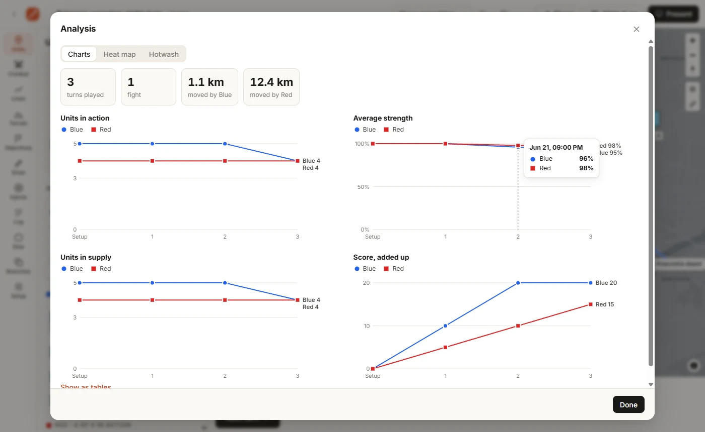

# Running and reviewing a game

These tools help the person running a [scenario](scenarios.md) in a meeting, and the room afterward. You'll find most of them in the **⋯** menu in the top bar, in the turn bar, and in the **Dice** panel.

## Second screen

Show the map on the projector while you keep the panels, upcoming injects and your notes on your own screen.

1. Select **⋯** in the top bar, then **Open a second screen**. A new window opens.
2. Drag it to the projector and press `F11` to make it full screen.

The second screen shows only the map and the turn bar, and follows your window: the turn, the branch, the view (pan and zoom), whose view is shown, the selected unit, overlays such as line of sight, the map grid, and inject banners. When you select **Continue** on an inject, it closes on both screens. While it's connected, the turn bar on your screen shows **Second screen**.

Both windows must be in the same browser on the same computer. Nothing is sent over the network, so it works offline too. If your browser blocks the new window, allow pop-ups for your Waymark site.

**Present** is the one-screen alternative: it hides the panels on the screen you're using.

## Map grid and coordinates

Select the **grid** button on the map (under the zoom buttons) to draw the military grid (MGRS, on UTM). The grid spacing follows the zoom: 100 m, 1 km, 10 km or 100 km, labeled along the top and left edges, with the UTM zone and spacing in the corner. Select it again to hide it. The grid also shows on the second screen.

Point at the map to see the grid reference and latitude and longitude under the pointer, at the bottom left. Each unit's panel shows its own grid reference at the top of **Movement and supply**.

## Measure distance and bearing

1. Select the **ruler** button on the map.
2. Click points along the route. While you draw, the bar at the bottom shows the current leg's distance and bearing, and the total.
3. Double-click or press `Enter` to finish.

A card lists each leg with its distance and its true bearing in degrees and in NATO mils (6,400 to a circle), plus the grid references at each end. Close the card or select **Clear the overlay** to remove the line.

## Range fans

A unit whose weapons or sensors only cover an arc can have a fan instead of a ring. In the unit's panel, under **Command and sensors**, set **Facing** (degrees from north: east is 90) and **Arc** (such as 90 for a 90° fan). Its range and sensor rings become fans, and it only spots and contacts units inside the arc. Leave **Arc** empty for all round.

The selected unit's sensor range is drawn as a thin teal ring (or fan), shortened by the [weather and light](#weather-and-daylight).

## Reinforcements and withdrawals

Script units that join or leave the game on a set turn.

**To schedule a reinforcement:**

1. In **Units**, under **Reinforcements and withdrawals**, select **Schedule a reinforcement**.
2. Give it a **Name**, **Side**, **Kind**, **Size**, optional **Speed**, and the turn it **Arrives on**.
3. Select **Choose entry point**, then click where it comes onto the map.

When that turn starts, the unit appears at its entry point and the log says it arrived.

**To schedule a withdrawal**, open the unit and set **Withdraws on turn**. It leaves the map when that turn starts.

The schedule belongs to the whole scenario, so it applies on every branch that reaches that turn. Select **Edit** to change a reinforcement, or **Move entry point** to place it again.

## Timeline

Select **⋯ → Timeline**, or **Timeline of the game** in the Injects panel, to see everything scripted, turn by turn:

- **Injects**: scheduled ones on their turn, and ones you release by hand once they're released.
- **Reinforcements** and **withdrawals**.
- **Weather** changes.
- **Areas**: a bar for the turns each one is active.

Columns already played are shaded, and the turn you're on is outlined. Use it before the meeting to check the shape of the game, and during it to see what's coming.

## Weather and daylight

### Daylight

Give the scenario a start time in **Setup → Clock → Game starts** (in any clock mode). Each turn is then **day**, **twilight** (sun up to 6° below the horizon) or **night** at the play area. The turn bar shows a sun, half-moon or moon; at night and twilight the map is shaded darker.

Daylight is worked out from the sun's position, using the play area's time zone. Waymark guesses the time zone from the map's longitude; set **Time zone (hours from UTC)** under **Setup → Weather and daylight** to get it exactly right, including daylight saving.

### Weather

The weather chip in the turn bar shows the current weather. On the latest turn, select it to change the weather for that turn and the turns after. You can also schedule changes under **Setup → Weather and daylight** (choose the weather and a turn, then **Schedule**), or make an inject change it (**When released, it changes** → **The weather**).

| Weather | Off-road speed | Road speed | Sensor range | Aircraft |
| --- | --- | --- | --- | --- |
| **Clear** | 100% | 100% | 100% | Fly |
| **Rain** | 80% | 95% | 80% | Fly |
| **Heavy rain** | 55% | 85% | 60% | Grounded |
| **Fog** | 90% | 85% | 30% | Grounded |
| **Snow** | 50% | 70% | 70% | Fly |
| **High winds** | 100% | 100% | 90% | Grounded |

Light adds to that: **twilight** cuts sensor range to 70% and off-road speed to 90%; **night** cuts sensor range to 40% and off-road speed to 75%. So at night in fog, sensors reach 12% of their range.

The effects on speed apply when there's [terrain](scenario-rules.md#terrain). The effects on sensors apply to [automatic spotting](scenario-rules.md#spotting) and to the sensor ring.

## Outcome tables

An outcome table settles a question the combat table doesn't cover, such as "Does the bridge hold?", "Is the cyber attack detected?" or "Do the evacuees get out in time?". Find them in **Dice**, under **Outcome tables**.

**To make one:**

1. Select **New outcome table**. It starts as an example you can change.
2. Write the **Question** and choose the **Dice** (d6, 2d6, d10, d20 or d100).
3. Under **Results**, give each result a range of totals, such as 2 to 5 for "It collapses". Totals beyond the table use its first or last result.
4. Under **Modifiers**, list what helps or hurts, each with a plus or minus, such as "Engineers on site, +2".
5. Select **Save**.

**To use one:** tick the modifiers that apply. **Chances** shows the exact chance of each result with those modifiers, before anyone rolls. Then select **Roll**, or type the total the room rolled on real dice. The result, the roll and the modifiers go into the log.

## Matrix arguments

For moves no table covers, especially political, information or cyber moves, use a **matrix argument** (under **Dice**):

1. Choose the **Side** making the move and describe **The action**.
2. List **Reasons for**, one per line, as the side argues its case.
3. List **Reasons against**, one per line, as the room argues back.
4. Optionally add a **Facilitator** modifier from −3 to +3.
5. Select **Roll two dice**.

Each reason for adds one, each reason against takes one away, and a total of 7 or more succeeds. The chance of success shows before you roll; with no net reasons it's 58%. The result goes into the log.

## Combat odds before rolling

In **Combat**, under the odds, Waymark shows what the combat table holds for that column before anyone rolls: how often the defenders fall back, and the average losses on each side. Use it to decide whether an attack is worth making. See [Combat](scenario-rules.md#combat).

## Replay

Select the **play** button in the turn bar to replay the branch from the start (or from the turn you're on). Choose the speed, 1, 2 or 4 seconds a turn, from the box beside it. Units glide along their moves each turn. Select **pause** to stop.

Stepping forward one turn, with the arrow or `→`, also animates the moves.

## Analysis

Select **⋯ → Analysis**, or **Charts, heat map and hotwash** in the Branches panel. Choose the branch at the top right.

### Charts

The **Charts** tab shows each side, turn by turn:

- **Units in action**
- **Average strength**
- **Units in supply**, if supply is tracked
- **Score**, if there are objectives (held, or added up, following the victory condition)

Above them are the turns played, the number of fights, and how far each side's units moved. Hover over a chart to read every side's value at a turn. Each side has its own marker shape and a label at the end of its line, so the charts don't depend on color alone. Select **Show as tables** for the same numbers as tables.

### Heat map

The **Heat map** tab shows where units spent the game: warmer areas had more units for more turns. Fights are marked in red and contacts in amber.

### Hotwash questionnaire

The **Hotwash** tab makes a short questionnaire for everyone who took part: their role, what went well, what to do differently, what surprised them, and how useful the exercise was.

1. Select **Create the questionnaire**.
2. Share the link with the room at the end of the meeting: **Copy link**, or show it on the screen. It works on phones and doesn't need an account.
3. Answers appear in the tab as they come in: how many, the average usefulness, the roles, and every comment.
4. Untick **Accepting answers** to close it.

When you [write up the game](scenarios.md#write-it-up), the story includes a **What participants said** section with the answers.

The questionnaire is a [form](forms.md) that saves answers in a hosted layer called "Hotwash: …", owned by whoever created it.

## Templates

A template is a scenario's starting point that you can reuse: sides, units in their starting positions, lines, terrain, objectives, injects, outcome tables, the schedule and the rules.

- **To save one**, open a scenario and select **⋯ → Save as template**. Played turns, branches and notes are left out. The template appears on the Scenarios tab with a **Template** label.
- **To use one**, select **New scenario** on the Scenarios tab and pick it under **From a template**, or choose **New scenario from this template** from its **⋯** menu. You get a fresh copy to play; the template doesn't change.
- **To change a template**, open it like any scenario.

## Scenario files

Move a scenario to another Waymark server, or keep a copy, as a file.

- **To download one**, select **⋯ → Download scenario file**. You get a `.waymark.json` file with everything in the scenario, including its terrain, branches and history.
- **To import one**, select **New scenario** on the Scenarios tab, then **Import a scenario file**, and choose the file. It opens as a new scenario of yours.

Saved maps and the hotwash questionnaire live on the server, so they aren't in the file. A scenario played on a saved map opens on the plain basemap after you import it on another server.

## Keyboard shortcuts

| Key | Does |
| --- | --- |
| `→` | Next turn played, animating the moves |
| `Enter` | Finish measuring |
| `Esc` | Stop measuring |
