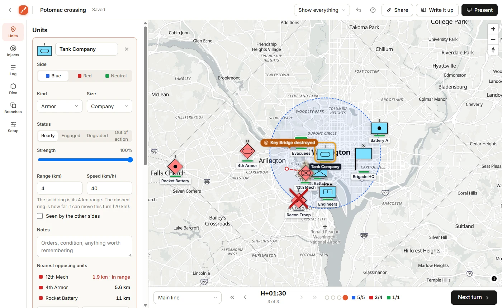

# Scenarios

A scenario is a tabletop exercise played on a map. You place units for each side, then move them turn by turn while the room talks it through. Along the way you can spring scripted events, roll dice, take notes, and branch off to try a different choice. When the game is over, one click writes it up as a story that replays it.

Scenarios are made for one screen in a meeting room: one person drives, everyone else watches the projector. They work for military wargames, emergency exercises, security planning, or any "what would we do if…?" discussion that happens on a map.

## Create a scenario

1. On the **Scenarios** tab of the home screen, select **New scenario**.
2. Choose what it's played on:
   - **A plain map**: just a basemap. Pan and zoom to your area.
   - One of your **saved maps**: its layers, styling and basemap appear under the units. Use this when the game depends on your own data, such as facilities, boundaries or routes.
3. The scenario opens ready to place units. Select the title at the top to rename it.

You can also start from the **Maps** tab: open a map's **⋯** menu and choose **New scenario on this map**.

Changes save by themselves. The top bar shows **Saved** when everything is stored.

## The scenario screen

| Part | What it's for |
| --- | --- |
| **Tools** (far left) | Switch the panel between **Units**, **Combat**, **Lines**, **Terrain**, **Objectives**, **Draw**, **Injects**, **Log**, **Dice**, **Branches** and **Setup**. |
| **Panel** | The controls for the chosen tool. |
| **Map** | The game board. Drag units here. |
| **Turn bar** (bottom) | The branch you're playing, the current turn, a tally of each side's units still in action, the score if there are objectives, and **Next turn**. |
| **Top bar** | **Show everything** (choose whose view to show), undo, help, **Share**, **Write it up** and **Present**. |

## Set up the game

Open **Setup** to describe the scenario before you start.

- **What this scenario tests**: the question the room is here to answer. It becomes the introduction of the after-action story.
- **Sides**: a new scenario has **Blue**, **Red** and **Neutral**. Rename them, change their colors, or select **Add a side**. The symbol frame (Friendly, Hostile, Neutral or Unknown) sets the shape drawn around that side's military symbols. A side can only be removed once it has no units.
- **Clock**: choose how turns are labeled.

  | Turns are shown as | Example |
  | --- | --- |
  | **Turn numbers** | Turn 3 |
  | **Hours elapsed** | H+01:30 |
  | **Date and time** | The real date and time, counted from **Game starts** |

  **Minutes per turn** is how much game time one turn covers. It also sets how far a unit with a speed can move in a turn.
- **Rules**: planned moves, automatic spotting, supply effects, ranges, and the combat and movement tables. See [Terrain, supply and combat](scenario-rules.md#rules).
- **Map**: for a scenario on a plain map, choose the **Basemap**. Select **Open on this view** to make the scenario open where the map is now.

Everything on this page works on its own. For a deeper game, [Terrain, supply and combat](scenario-rules.md) adds ground that slows units down, supply lines that can be cut, a combat table, objectives and planning graphics.

## Place units

1. Open **Units**.
2. Under **Add units for**, choose the side.
3. Choose the **Kind** and, for military units, the **Size** (team to division).
4. Select **Place on the map**, then click the map. Keep clicking to place more of the same.
5. Select **Done placing**, or press `Esc`, when you've finished.

Military kinds (infantry, armor, artillery, engineers, aircraft, warships and so on) are drawn as standard military map symbols in the side's frame. Civil kinds (police, fire and rescue, ambulance, command post, shelter, civilians, hazard and others) are drawn as a labeled badge in the side's color.

The turn before the first one is called **Setup**. Place everyone's starting positions there, then select **Start turn 1**.

### Import units from a spreadsheet

For a large order of battle, list the units in a spreadsheet and import it as a CSV file.

1. In **Units**, select **Template** to download an example file, and fill it in. One row per unit.
2. Select **Import from a spreadsheet** and choose your file.
3. Check the summary (how many units for each side, and anything that couldn't be read), then select **Add units**.

| Column | What to put |
| --- | --- |
| `name` | The unit's name. Required. |
| `side` | The side's name, such as Blue. A name Waymark doesn't know becomes a new side. |
| `kind` | Such as Infantry, Armor, Artillery, Headquarters, Police or Civilians. Common words like "tank" work too. |
| `size` | Team, squad, platoon, company, battalion, brigade or division. |
| `strength`, `status` | 0 to 100, and ready, engaged, degraded or out of action. |
| `latitude`, `longitude` | Where it starts. Rows without them are laid out in a block in the middle of the map. |
| `range_km`, `speed_kmh`, `sensor_km` | Optional ranges and speed. |
| `reports_to` | The name of its headquarters, for the [command rules](scenario-rules.md#command-and-contact). |
| `mobility`, `seen`, `notes` | Optional: how it moves (on foot, wheeled, tracked…), whether the other sides can see it (yes or no), and notes. |

## Edit a unit

Click a unit on the map or in the list to open it.

| Setting | What it does |
| --- | --- |
| **Name** | The label under the symbol. |
| **Side**, **Kind**, **Size** | Change what the unit is. |
| **Status** | **Ready**, **Engaged**, **Degraded** or **Out of action**. A unit that is out of action stays on the map, faded, and no longer counts in its side's tally. |
| **Strength** | From 0 to 100%. Shown as a bar under the symbol. |
| **Range (km)** | Draws a solid ring around the unit when it's selected, and marks which opposing units are in range. |
| **Speed (km/h)** | Sets how far the unit can move in one turn. A dashed ring shows the limit. Leave it empty to allow any distance. With [terrain](scenario-rules.md#terrain), an empty speed means the usual speed for that kind of unit. |
| **Seen by the other sides** | Whether the unit appears when the map is shown as another side. See [Hide what a side can't see](#hide-what-a-side-cant-see). |
| **Notes** | Orders, condition, or anything else worth remembering. |

**Nearest opposing units** lists the three closest units of other sides with their distances, and says which are in range.

Below that, **Movement and supply** and **Command and sensors** hold the settings for the deeper rules: how the unit moves, its supply, the headquarters it reports to, its sensor range and its combat value. See [Terrain, supply and combat](scenario-rules.md).

Every change to status or strength is written to the turn's log. You can also remove a unit from the board with the button at the bottom of its panel.

## Move units

Drag a unit to move it. A dashed line shows where it started the turn, and the unit's panel shows how far it has moved.

If the unit has a speed and you drag it farther than it could travel in one turn, Waymark still lets you, and tells you by how much it went over, with an **Undo** button. The room decides whether the move stands.

With [terrain](scenario-rules.md#terrain), the move follows the quickest route over the ground instead of a straight line, and the log records how long it took and how much supply it used. With [planned moves](scenario-rules.md#planned-moves) turned on, dragging plans the move instead of making it.

## Planning aids

With a unit selected, the buttons at the bottom of its panel answer common questions:

- **Line of sight** shades what the unit can and can't see, given the terrain. Green is visible, red is hidden. It uses the same elevation data as the [3D viewshed & line of sight](analysis-tools.md#3d-viewshed--line-of-sight) analysis tool.
- **Reach by road** and **On foot** draw the area the unit could get to in one turn along the road and path network, using the same service as the [Travel-time areas](analysis-tools.md#travel-time-areas) tool.

Select **Clear the overlay** on the map to remove the shading. Both aids need an internet connection, because the elevation and routing data come from online services.

## Play turns

- Select **Next turn**, or press `N`, to start the next turn. Every unit begins it where it ended the last one.
- Use the arrows in the turn bar, or the left and right arrow keys, to step back and forward through the game. The dots show how many turns have been played.
- Earlier turns are read-only, so history can't be changed by accident. From an earlier turn you can:
  - **Branch from here** to play a different choice from that point. See [Branches](#branches).
  - **Replay from here** to throw away the later turns of this branch and carry on from this one.
- **Undo** (`Ctrl+Z`) takes back your last change, including starting a turn or deleting a branch.

## Injects

An inject is an event the facilitator springs on the room: a bridge is blown, the weather closes in, a message arrives. Prepare them before the meeting, then release them during play.

1. Open **Injects** and select **New inject**.
2. Give it a **Title**, and under **Details** write what the facilitator reads out.
3. Under **Release**, choose when it happens: **When I release it** waits until you select **Release now**; choosing a turn makes it appear by itself when that turn starts.
4. If the scenario has [lines of communication](scenario-rules.md#lines-of-communication), choose what **When released, it changes**: for example, "Rail bridge" and **Cuts it**.
5. Optionally select **Pin to the map**, then click where it happens. Without a pin, select **Add inject**.

To load a whole script of injects at once, select **Template** under the list for an example CSV file (columns `title`, `details`, `turn`, `latitude`, `longitude`; leave `turn` empty for injects you release by hand), fill it in, then select **Import from a spreadsheet**.

When an inject is released, a banner appears over the map with its title and text until you select **Continue**. It's written to the log, and if it has a pin, a marker stays on the map from that turn on. **Show again** brings the banner back.

Injects belong to the whole scenario, so each branch can release them at its own time.

## Dice

Open **Dice** to settle an outcome with a roll.

- Type **What is this roll for?**, such as "Does the bridge hold?".
- Select a die (**d6**, **2d6**, **d10**, **d20** or **d100**), or set a **Chance of success** as a percentage and select **Roll** for a plain success or failure.

Rolls on the current turn are added to the log with what they were for.

## Log and notes

Open **Log** to see everything that happened on the turn: moves with their distances, status and strength changes, injects and dice rolls. Select **Show the whole game** to see every turn of the branch.

Use the notes box to record what the log can't: the decisions the room made, and why. Notes are kept per turn and go into the after-action story.

## Branches

A branch plays out a different choice from some point in the game, without changing what you've already played.

1. Go to the turn where the choice was made.
2. Select **Branch from here** in the turn bar, or open **Branches** and use the button at the bottom of the list.
3. Name the alternative, such as "Blow the bridge first".

The new branch starts as a copy of the game up to that turn. Switch between branches with the picker at the left of the turn bar, or **Open** in the Branches panel. Deleting a branch doesn't affect the others.

### Compare branches

Open **Branches** and select **Compare branches**. Two branches are shown side by side, each with a map of how it ended and a table of every side's units in action, units lost, average strength, units in supply and, if there are objectives, the score. Change either picker to compare a different pair.

## Hide what a side can't see

The picker at the top (**Show everything**) changes whose view the map shows. Choose a side to hide every unit of the other sides that isn't marked **Seen by the other sides**, along with the other sides' lines, depots, graphics and planned moves. Use it when you turn the screen toward one team, or to check what a side knows before it decides. With [automatic spotting](scenario-rules.md#spotting) on, units seen by the other side's sensors appear too.

This is a display setting for the room. It isn't a security control: anyone who can open the scenario can switch back to **Show everything**.

## Present

Select **Present** to fill the screen with the map and the turn bar, with the panels hidden. Everything still works: drag units, start turns, release scheduled injects. Click a unit to see a card with its side, kind, status and strength.

Press `Esc`, or select **Exit**, to bring the panels back.

## Write it up

Select **Write it up** to turn the game into a [story](stories.md).

1. If the scenario has more than one branch, choose the **Branches to include**.
2. Select **Create the story**.

The story opens in the story editor in a new tab. It has:

- The scenario's title and what it tests.
- For each branch, a moving map with one card per turn: what happened, the injects released, and your notes, with the map moving to where the action was. The maps also show lines of communication (cut ones in red), objectives with who held them, and your planning graphics.
- Big numbers for how each branch ended.
- A comparison of the branches, and a section for what you learned.

It's an ordinary story from then on: edit the text, add photos, then [publish or share it](publish.md). Later changes to the scenario don't change the story. Write it up again to get a fresh one.

## Share a scenario

Select **Share** to give other people or groups access, as with any other item. See [Sharing and teams](sharing.md).

- People who can only view can step through the turns, switch branches and compare them, but can't change anything.
- People who can edit can play the game. Only one person should play at a time. If the scenario changes somewhere else while you have it open, Waymark asks you to load the latest version.
- Turn on the public link to get a read-only page at `/w/…` that anyone can open without an account. If the scenario is played on a saved map, that map and its layers become readable through the link too.

## Keyboard shortcuts

| Key | Does |
| --- | --- |
| `N` | Start the next turn |
| `←` `→` | Previous or next turn |
| `Esc` | Stop placing or drawing, close the selected unit, or leave Present |
| `Enter` | Finish the line or area you're drawing |
| `Backspace` | Remove the last point while drawing |
| `Ctrl+Z` | Undo |
