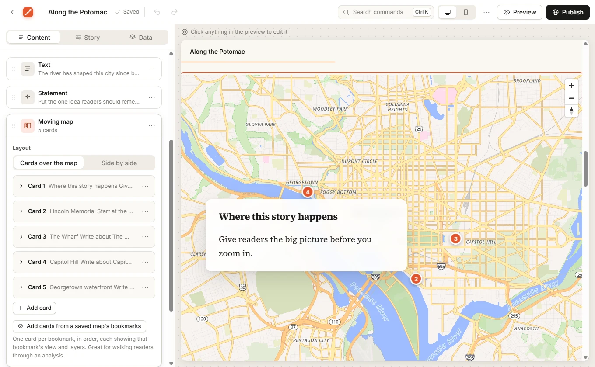

# The story editor

The story editor is where you write, arrange and style a story. This page tours every part of it. For the settings of each kind of block, see the [Blocks reference](blocks.md).

## Open a story

- **New story:** on the **Stories** tab, select **New story** to start the wizard. See [Quick start](get-started.md#make-a-story-with-the-wizard).
- **Existing story:** click its card on the **Stories** tab.
- **A story someone shared with you:** it appears on your Stories tab with the owner's name. If you're an editor it opens in the editor; if you're a viewer it opens as a preview.

## Parts of the editor

| Part | What it does |
| --- | --- |
| **Top bar** | The story title (click to rename), save status, undo and redo, **Search commands**, desktop and phone preview, the **⋯** menu, **Preview** and **Publish**. |
| **Panel** (left) | Three tabs: **Content** (the blocks), **Story** (cover, look, motion, credits) and **Data** (the story's layers). When a block is open, its settings show here. |
| **Preview** (right) | The story as readers will see it. Click anything to edit it. |

### Content tab
Lists the story's blocks in order. Click a block to open its settings. Drag the handle to reorder. The **⋯** on a block offers **Move up**, **Move down**, **Duplicate** and **Delete**. Deleting shows an **Undo** button for a few seconds.

Stories made with the wizard also show a **Finish your story** checklist here: add a cover photo, replace the placeholder text (with a count of what's left), add photos, put data on the map, check where the map goes on each card, preview on a phone, and publish. Click a step to jump to it. Hide the checklist with its **×**.

### Story tab
| Setting | What it does |
| --- | --- |
| **Subtitle** | One line under the title on the cover. |
| **Small label above the title** | An optional kicker such as "Field notes". |
| **Cover image** | The photo behind the title. Upload one, paste a link, or choose **Library** to reuse an image you've uploaded before. |
| **Cover motion** | **Still**, **Parallax** (the photo moves slower than the page) or **Zoom** (the photo slowly zooms as you scroll). |
| **Author** and **Date** | Shown under the title. |
| **Look** | The story's design. See [Looks](#looks). |
| **Scroll animations** | **Off**, **Subtle** or **Expressive**: how blocks animate into view. Readers who turn on "reduce motion" in their device settings always get a still page. |
| **Sources and credits** | Shown at the end of the story. |

### Data tab
Lists the layers this story can show on its maps, with buttons to **Browse public data**, add **Hosted feature layers**, add **Your data** (files and links), **Analyze** and **Draw**. Click a layer to open its settings. See [Add data](add-data.md) and [Style and configure layers](layer-settings.md).

A layer added here is available to every map in the story; each map chooses which layers it shows.

## Add, move and remove blocks

**To add a block**
1. Select **+** between two blocks, or press <kbd>/</kbd> (the new block goes after the one that's open).
2. Pick a block. Blocks are grouped into **Write**, **Media**, **Maps** and **Scroll effects**.

**To move a block**, drag it in the Content tab, use **Move up**/**Move down** in its **⋯** menu, or press <kbd>Alt</kbd>+<kbd>↑</kbd> / <kbd>Alt</kbd>+<kbd>↓</kbd> while it's open.

**To duplicate a block**, use **Duplicate** in its menu or press <kbd>Ctrl</kbd>+<kbd>D</kbd> (<kbd>⌘</kbd>+<kbd>D</kbd> on a Mac).

**To delete a block**, use **Delete** in its menu or press <kbd>Delete</kbd> while it's open, and select **Undo** in the message if you change your mind.

## Write and format text

Text blocks and moving-map cards use a rich text editor with a formatting bar: **Bold**, **Italic**, **Heading**, **Subheading**, **Normal text**, **Bulleted list** and **Link**. In moving-map cards the bar also has **Map link**, which makes selected words move the map. See [Map links](story-maps.md#map-links).

Paste from Word, Google Docs or a web page and Waymark keeps headings, lists, bold, italic, underline, quotes and links, and drops other formatting and anything unsafe.

## Looks

A look restyles the whole story: typefaces, colors, chapter colors, the basemap style of its maps, and the scroll animation.

| Look | Feel |
| --- | --- |
| **Classic** | Warm paper and elegant serif type. |
| **Night** | Dark and cinematic, so photos and maps glow. |
| **Brutalist** | Raw type, hard edges and loud color. |
| **Atlas** | An old atlas: parchment, engraved type, sepia maps and a compass rose. |
| **Aurora** | Dark glass and drifting light; map data glows like fireflies. |
| **Editorial** | Newsprint, high-contrast display serifs, crimson rules and drop caps. |
| **Blueprint** | A deep blue grid, cyan hairlines and glowing data. |
| **Fog** | A fog storm that lifts as readers scroll, with a lantern that follows the pointer. |

**To change the look**
1. Open the **Story** tab.
2. Under **Look & feel**, pick a look. The preview updates immediately.
3. If the story has chapters or maps, a message offers to **Match chapter colors and maps**. Select it to restyle them too. Imagery basemaps (satellite, USGS imagery) are left as they are.

## Undo, redo and saving

- Every change saves automatically about a second after you stop typing. The status reads **Editing…**, **Saving…** and then **Saved**. Press <kbd>Ctrl</kbd>+<kbd>S</kbd> to save immediately.
- **Undo** and **Redo** are in the top bar, or press <kbd>Ctrl</kbd>+<kbd>Z</kbd> and <kbd>Ctrl</kbd>+<kbd>Shift</kbd>+<kbd>Z</kbd>.
- If the same story is changed in another tab or by a co-editor, Waymark tells you and offers to load the latest version, so nobody silently overwrites anyone.

## Find any command

Press <kbd>Ctrl</kbd>+<kbd>K</kbd> (<kbd>⌘</kbd>+<kbd>K</kbd> on a Mac), or select **Search commands** in the top bar, and type what you want: "add map", "publish", "phone preview", "export". Press <kbd>?</kbd> to see all [keyboard shortcuts](shortcuts.md).

## Preview on a phone

Select the phone button above the preview to see the story at phone width. Every block is designed to work on phones: moving maps stack the map above the cards, galleries scroll sideways, and maps don't capture page scrolling. Select **Preview** to open the draft in a new tab, which you can also open on your phone while signed in.

## The ⋯ menu

| Item | What it does |
| --- | --- |
| **Open preview in new tab** | Same as **Preview**. |
| **Story settings** | Opens the Story tab. |
| **Export as a website…** | Downloads the story as a website you can host anywhere. See [Export and print](export.md#export-a-story-as-a-website). |
| **Download story file** | Saves the story as a `.waymark.json` file you can import later. |
| **Import a story file…** | Replaces this story's content with a file you downloaded before. |
| **Keyboard shortcuts** | Shows the shortcut list. |

## Next steps

- [Blocks reference](blocks.md): every block and its settings.
- [Maps in stories](story-maps.md): map views, moving maps, tours and comparisons.
- [Publish and update](publish.md): links, updates and sharing.
