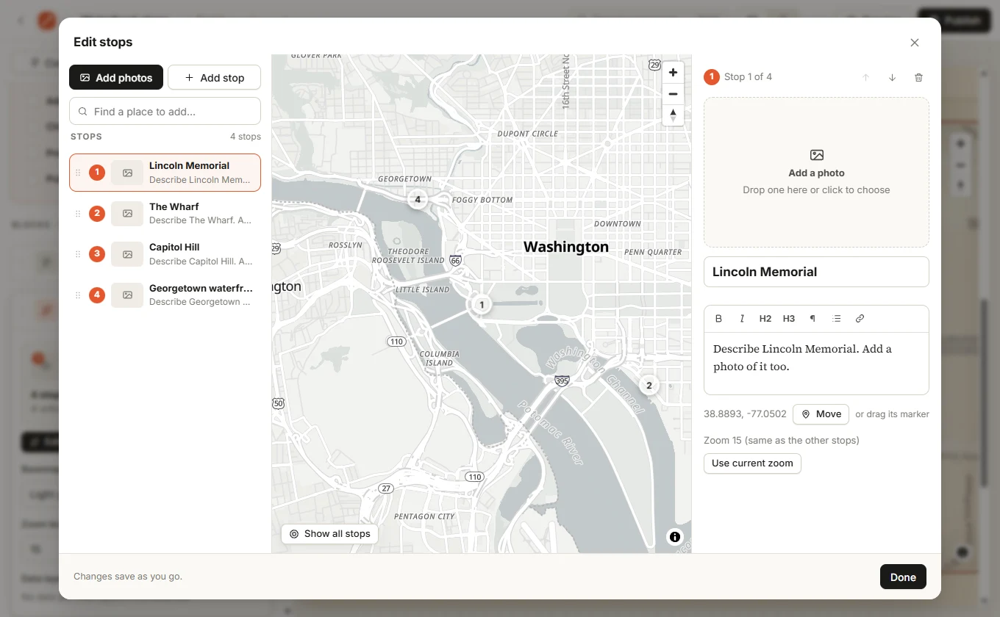

# Maps in stories

Every map in a story is set up the same way: you frame a view, choose which layers show, and optionally add markers or drawings. This page covers that, then each map block in turn: map links in moving maps, the tour builder, comparisons, and using saved maps.

## Set a map view

A **view** is everything about how a map looks at one moment: where it's centered, how far it's zoomed, its rotation and tilt, the basemap, the visible layers, markers, 3D settings and the time slider's position.

**To set a view**
1. Open a Map block, a moving-map card, a stop-by-stop block or a before & after block.
2. Select **Edit map**. The map picker opens.
3. Frame the view:
   - Drag to move, scroll to zoom.
   - Right-drag to rotate, <kbd>Ctrl</kbd>-drag to tilt.
   - Or type a place in **Search for a place**.
4. In the side panel, set:
   - **Basemap**: the background map.
   - **Markers**: click the map to drop a numbered marker, and give it an optional label that readers see when they click it. Select the **×** next to a marker to remove it.
   - **Data layers**: tick the story layers this map shows. **Add public data** opens the catalog without leaving the picker.
   - **Show legend**: whether readers see the legend.
   - **3D**: turn on terrain, set the **Vertical exaggeration** and **Camera tilt**, and turn on 3D buildings (visible when zoomed in to street level).
5. Select **Use this view**.

Readers see the map exactly as you framed it, and can then pan, zoom and click features themselves. Maps never capture page scrolling; readers zoom with the + and − buttons or by pinching.

> [!TIP]
> If the story uses a saved map, the picker also offers that map's bookmarks. See [Use a saved map](#use-a-saved-map).

## Draw on a map

Every map in the editor has a **Draw** button next to **Edit map**. It opens the drawing tools on exactly that map, over its other layers. Draw points, lines, freehand routes, areas, boxes, circles and text labels, style each one, then select **Add to this map**. The drawing becomes a layer that's switched on for that map. Select **Draw** again to keep editing it. See [Draw and measure](draw-measure.md).

## Moving maps

A moving map pairs a column of story cards with a map. As each card scrolls into view, the map flies to that card's view.

**To build a moving map**
1. Add a **Moving map** block.
2. Choose a **Layout**: **Cards over the map**, or **Side by side**.
3. For each card, write the text, and under **Beside this card, show** pick **Map** (then **Edit map** to set its view), **Image**, **Video** or **Embed**.
4. Select **Add card** for more steps, and drag cards to reorder them.

Cards can mix media: a map card followed by a photo card and back to the map.

### Map links

A map link is a phrase in a card's text that moves the map somewhere else when readers click it, such as "the **old harbor**" flying to the harbor.

**To add a map link**
1. In a moving-map card, select the words that should move the map.
2. Select **Map link** in the formatting bar. The map picker opens.
3. Frame the view for those words and select **Use this view**.

The words are highlighted in the editor. Click a map link to change where it goes, move it to other words, or remove it. The list under the card shows every link with its words.

### Walk readers through a saved map

If you made a saved map with bookmarks, a moving map can step through them, one card per bookmark.

1. In a Moving map block, select **Add cards from a saved map's bookmarks**.
2. Choose the map. Each bookmark becomes a card showing that bookmark's view and layers, with the bookmark's note as the card's text.
3. Edit the text of each card.

Or start a whole story this way: in the map editor, select **Use in a new story**. See [The map editor](map-editor.md#use-a-map-in-stories).

## Build a tour

**Stop by stop** steps readers through numbered places. Each stop has a photo, a title and a few lines of text, and the map moves to the stop as readers press next.

**To build a tour**
1. Add a **Stop by stop** block, or open one and select **Edit stops**. The tour builder opens.
2. Add stops in any of these ways:
   - **Drop photos** on the builder. Photos taken on a phone are placed where they were taken, in the order you took them, and named after the file. Photos without a location are marked **Needs a location**: select one, then click the map to place it.
   - **Search for a place** with **Find a place to add…**.
   - Select **Add stop**, then click the map.
3. Select a stop to edit its photo, name and description.
4. To move a stop, drag its marker on the map, or select **Move** and click the new spot. Drag stops in the list to reorder them, or use the arrows above the selected stop.
5. To set how close the map goes for one stop, zoom the map and select **Use current zoom**. Otherwise the block's **Zoom level at each place** applies.

Changes save as you go.

## Compare maps with before & after

A **Before & after** block shows two maps in one frame. Readers drag the divider to compare.

1. Add a **Before & after** block and select **Edit map** to set the shared view.
2. Give each side a label, such as "1990" and "2024".
3. Choose a **Left basemap** and a **Right basemap**, and **Left data layers** and **Right data layers**, to compare different data over the same place.

### Compare two dates from space

Set **Satellite Time-Travel sensor** to compare daily imagery from two dates. Pick the **Left satellite date** and **Right satellite date**.

| Sensor | Good for |
| --- | --- |
| MODIS True Color (daily) | Natural color views of large areas. |
| VIIRS True Color (daily) | Sharper daily natural color. |
| False-Color Infrared 7-2-1 | Burn scars, floods, and seeing through smoke. |
| NDVI Vegetation Health (8-day) | Drought and greening. |
| Sea Surface Temperature | Ocean heat. |
| Snow & Ice Cover (NDSI) | Snow extent. |
| Smoke, Dust & Aerosol (AOD) | Wildfire smoke and dust storms. |

This imagery is from NASA GIBS. It's coarse (roughly 250 m to 2 km per pixel), so it suits regional changes, not individual buildings.

## Use a saved map

A [saved map](map-editor.md) keeps its layers, styles, analysis and bookmarks in one place. Any map in a story can use one, and the story always shows the map's latest version.

**To use a saved map in a map block or card**
1. Select **Edit map**, then **Use a saved map**, and pick the map.
2. Choose a **bookmark** to show its view and layers, or choose **Custom view and layers** and frame your own view with any of the map's layers.
3. Select **Use this view**.

To switch maps, choose **Use a different saved map**. To stop using it, choose **Stop using the saved map** (its layers are removed from this view).

Published stories load saved maps live, so when you edit the map, readers see the change without the story being republished. An exported website gets a copy of the map instead. See [Export and print](export.md).

## Time and maps

If a layer has a time field (see [Time](layer-settings.md#time)), maps that show it get a time slider with a play button. Readers can scrub through it. Each view and bookmark remembers where the slider was set, so a moving map can show "the first week" on one card and "the whole month" on the next.
